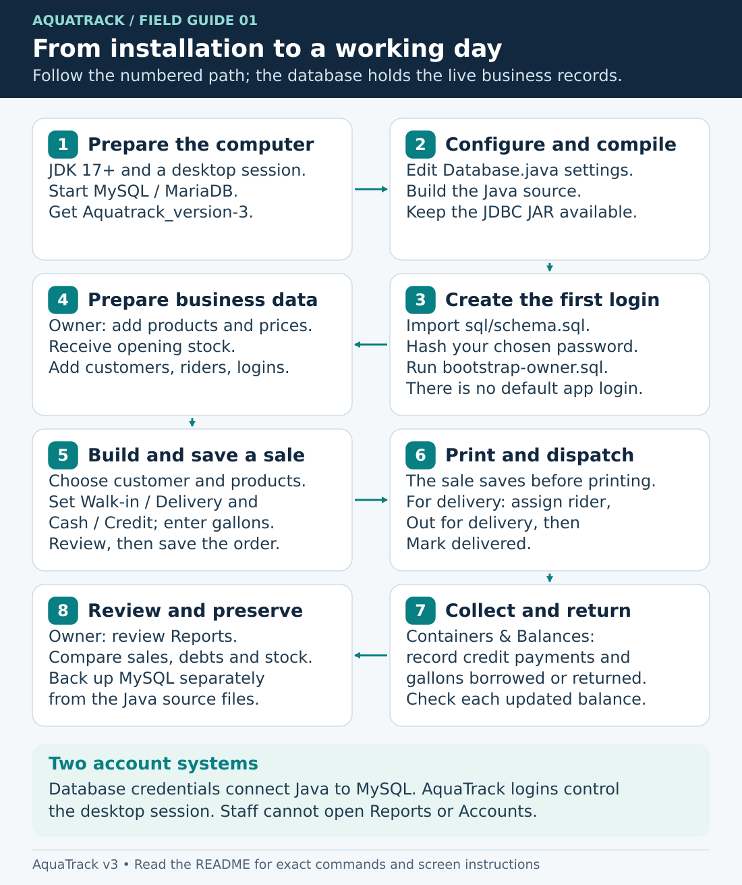
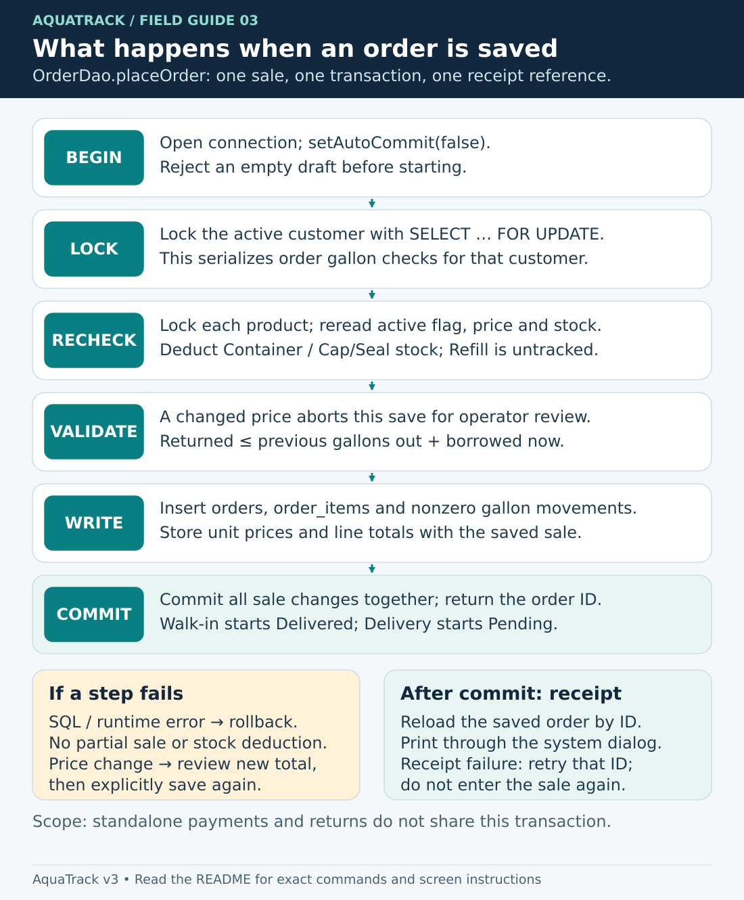
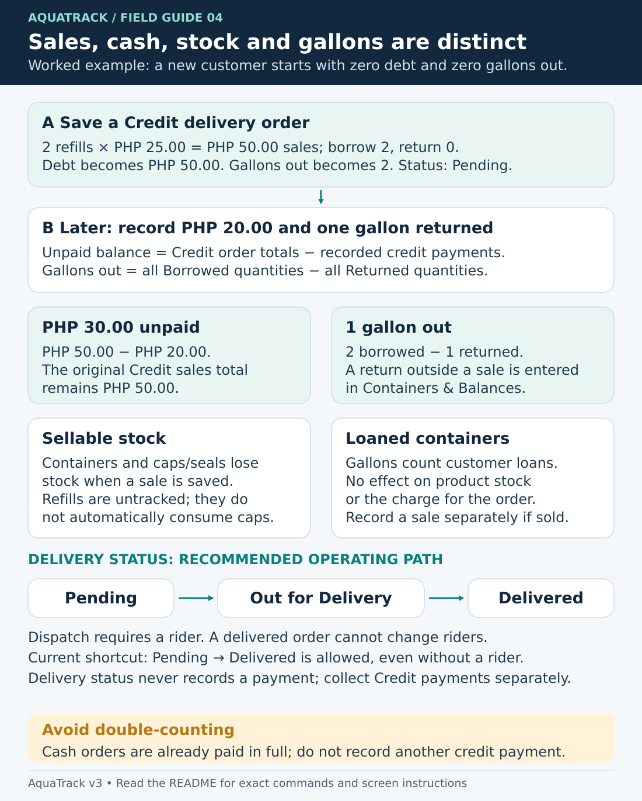
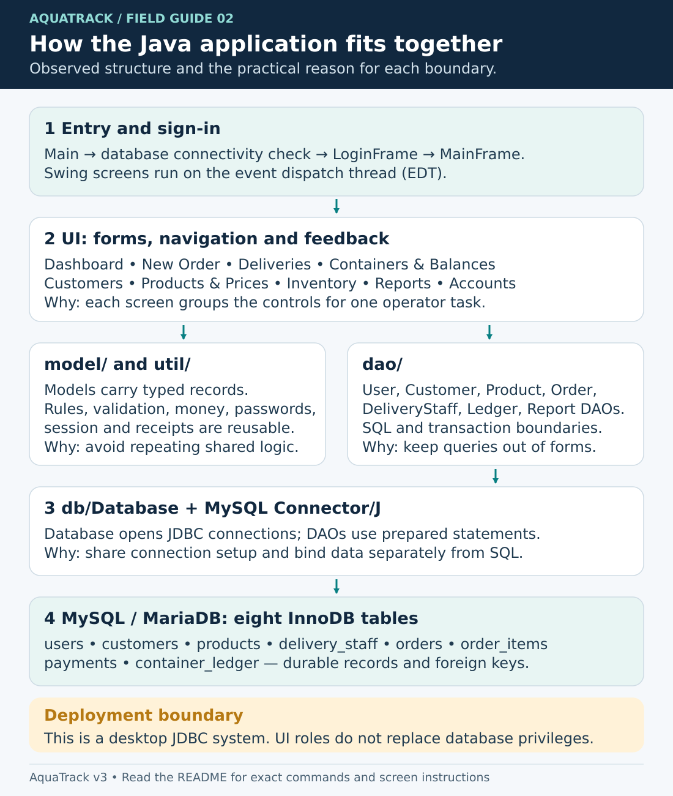

# AquaTrack — complete user and developer handbook

AquaTrack is a desktop application for a water refilling station. It manages customers, cash and credit orders, delivery riders, returnable gallon containers, inventory, unpaid balances, receipts, and sales reports. The main application lives in **[`Aquatrack_version-3/`](Aquatrack_version-3/)**.

This repository also contains earlier Java Swing exercises. They are separate applications with different entry points and database requirements; see [Other projects](#other-projects).

**Read offline:** [Download the illustrated PDF handbook](docs/downloads/AquaTrack-Handbook.pdf). It includes this guide, the infographics, and the detailed architecture chapter. On GitHub, open the PDF and select **Download raw file** to save it to your phone or computer. PDF preserves the diagrams, page layout, and searchable text for offline study.

**Understand the implementation:** [How and why AquaTrack is coded this way](docs/architecture.md) traces the source, database design, calculations, transactions, and tradeoffs. The explanations describe the supplied code; design reasons are identified as engineering interpretations where the author has not recorded an intention.

## Choose your learning path

| You want to… | Read in this order | What you should be able to do |
| --- | --- | --- |
| Install a fresh copy | Requirements → Install and run → First-time operating setup | Build the Java source, create the database, and sign in as the first owner. |
| Operate the station | Roles and access → Using AquaTrack → First-day walkthrough → Daily operating checklist | Record sales, dispatch deliveries, collect credit payments, and track returned gallons. |
| Understand or extend the code | How and why the system is formulated → Developer notes → [Architecture chapter](docs/architecture.md) | Follow a button click to its SQL, explain each formula, and identify where a change belongs. |
| Teach or revise offline | Download the PDF and use the [visual index](#infographic-index) | Study the same workflows and implementation details without an internet connection. |

The main application is a **Java Swing desktop client that connects directly to MySQL through JDBC**. There is no browser server. The application stores business records in MySQL; the GitHub repository stores the program and its learning material.



### Infographic index

Open any image to zoom into its vector text. Each diagram is also explained in prose in this handbook.

| Infographic | What it teaches |
| --- | --- |
| [01 · Operating workflow](docs/images/01-operating-workflow.svg) | Installation, first-use setup, sales, delivery, settlement, and review. |
| [02 · System architecture](docs/images/02-system-architecture.svg) | How the Swing screens, models, rules, DAOs, JDBC driver, and database fit together. |
| [03 · Saving an order](docs/images/03-order-transaction.svg) | Validation, row locks, price and stock checks, commit/rollback, and receipt loading. |
| [04 · Money and containers](docs/images/04-money-containers.svg) | A worked credit-sale example, loan counts versus stock, and delivery states. |
| [05 · Database model](docs/images/05-data-model.svg) | The eight tables, foreign-key relationships, saved history, and customer-level balances. |

## Contents

- [Choose your learning path](#choose-your-learning-path)
- [Infographic index](#infographic-index)
- [Repository layout](#repository-layout)
- [Requirements](#requirements)
- [Install and run AquaTrack](#install-and-run-aquatrack)
- [Using AquaTrack](#using-aquatrack)
- [First-day walkthrough](#first-day-walkthrough)
- [Daily operating checklist](#daily-operating-checklist)
- [Backup and restore](#backup-and-restore)
- [Troubleshooting](#troubleshooting)
- [Developer notes](#developer-notes)
- [How and why the system is formulated](#how-and-why-the-system-is-formulated)
- [Glossary](#glossary)
- [Maintain the documentation](#maintain-the-documentation)
- [Other projects](#other-projects)

## Repository layout

```text
JAVA_GIU_SWING_DATABASE_PT/
├── Aquatrack_version-3/          Main water-station application
│   ├── src/aquatrack/
│   │   ├── Main.java            Application entry point
│   │   ├── db/                 JDBC connection settings
│   │   ├── dao/                Database queries and transactions
│   │   ├── model/              Users, products, customers, orders
│   │   ├── ui/                 Swing screens and dialogs
│   │   └── util/               Validation, passwords, receipts, rules
│   ├── sql/                    Fresh database and first-owner setup
│   ├── lib/                    Bundled MySQL JDBC driver and build library
│   ├── nbproject/              NetBeans Ant project
│   └── build.xml
├── LoginSystem/                Original Twilight Peaks login/climber demo
├── LoginSystem_PT/LoginSystem/  Integrated Twilight Peaks CRUD variant
├── GUI/                        Hotel-room GUI prototype
└── docs/
    ├── architecture.md         Detailed implementation and design chapter
    ├── images/                 Editable SVG infographics
    ├── downloads/              Illustrated offline PDF handbook
    └── tools/                  Scripts that rebuild the visuals and PDF
```

Build from the current AquaTrack source. The repository includes the required libraries and shared NetBeans configuration; generated `build/` and `dist/` output, private IDE settings, and the old project ZIP are omitted. The other demo folders retain their existing contents. Ignore rules prevent new generated output and private IDE settings from being added; they do not remove files already in Git history.

## Requirements

| Requirement | Notes |
| --- | --- |
| JDK 17 or later | A full **JDK** is required to compile. JDK 21 is a suitable choice. Both `java` and `javac` should be on `PATH`. |
| MySQL-compatible database server | MySQL 8.0.16+ or MariaDB 10.4+; XAMPP's MySQL/MariaDB service is a convenient local option. |
| JDBC driver | Included as `Aquatrack_version-3/lib/mysql-connector-j-26.7.0.jar`. Keep it on the runtime classpath. |
| Desktop session | Swing needs a graphical display. The main window has a minimum size of 1000 × 660. |
| Git | Optional if downloading the repository ZIP instead. |
| Apache NetBeans / Apache Ant | Optional; direct JDK commands are also provided. |

AquaTrack uses PHP currency formatting, Philippine mobile numbers (`09` followed by nine digits), and a JDBC timezone setting of `Asia/Manila`. Apache is needed for XAMPP's browser-based phpMyAdmin interface, but the desktop application itself talks directly to MySQL and does not require a web server.

## Install and run AquaTrack

Follow these steps in order: get the source, configure the connection, build, create the database, create the first owner, and launch.

### 1. Get the source

```sh
git clone https://github.com/ideki4444/JAVA_GIU_SWING_DATABASE_PT.git
cd JAVA_GIU_SWING_DATABASE_PT
```

If the restoration/documentation pull request has not yet merged, run `git switch codex/aquatrack-learning-handbook` to use the complete project and handbook. After it is merged into `main`, that extra step is unnecessary. Then:

```sh
cd Aquatrack_version-3
java -version
javac -version
```

Alternatively, select the branch containing `Aquatrack_version-3` on GitHub, use **Code → Download ZIP**, extract it, and open a terminal in `Aquatrack_version-3`.

### 2. Start the database and check connection settings

Start the MySQL/MariaDB service. With XAMPP, start **MySQL** in its control panel. Start **Apache** too if you will use phpMyAdmin.

The current settings are in [`Database.java`](Aquatrack_version-3/src/aquatrack/db/Database.java):

```java
private static final String URL = "jdbc:mysql://localhost:3306/aquatrack?serverTimezone=Asia/Manila";
private static final String USER = "root";
private static final String PASSWORD = "";
```

These are local XAMPP defaults. If your server uses another host, port, database, or database-account password, change these constants **before building**. The application does not currently load `.env` files, environment variables, or a settings file. Keep real credentials out of commits. The MySQL account and the AquaTrack sign-in account are separate identities.

For a local shared installation, use a database account with only `SELECT`, `INSERT`, `UPDATE`, and `DELETE` privileges on `aquatrack.*` after an administrator has imported the schema. Schema import requires database/table creation privileges. Keep the database on a trusted local network; this desktop application's role controls are not a substitute for database access controls.

### 3. Compile the application

All commands in this section run from `Aquatrack_version-3`.

**Linux/macOS:**

```sh
mkdir -p out
find src -name '*.java' > sources.txt
javac --release 17 -encoding UTF-8 -cp 'lib/*' -d out @sources.txt
```

**Windows PowerShell:**

```powershell
New-Item -ItemType Directory -Force out | Out-Null
$javaSources = (Get-ChildItem -Path src -Recurse -Filter *.java).FullName
javac --release 17 -encoding UTF-8 -cp "lib/*" -d out $javaSources
```

A successful compile creates `out/aquatrack/Main.class` and the other classes. Compilation does not require the database to be running.

**NetBeans alternative:**

1. Select **File → Open Project** and choose `Aquatrack_version-3`, which contains `build.xml` and `nbproject`.
2. In **Project Properties → Libraries**, choose your installed JDK 17+ and confirm `lib/mysql-connector-j-26.7.0.jar` resolves.
3. Under **Sources**, use source/binary format 17. Under **Run**, verify the main class is `aquatrack.Main`. These are set in the shared project properties.
4. Use **Clean and Build**. Complete the database and first-owner steps below before **Run Project**.

NetBeans writes compiled classes under `build/classes`. If you build only with NetBeans or Ant, substitute `build/classes` for `out` in the password-hash command below. NetBeans will create private local settings for your computer.

### 4. Create the database

The supplied [`sql/schema.sql`](Aquatrack_version-3/sql/schema.sql) provisions a fresh database. It creates eight InnoDB tables and no sample products, customers, transactions, or accounts. It does not migrate an incompatible existing database. Use a separate test database/server or back up an existing installation before changing its schema.

From the project directory, open a MySQL client:

```sh
mysql -u root -p
```

Enter the database account password. On a local XAMPP installation with a blank root password, press Enter. If the command is not on PATH, Windows PowerShell can run:

```powershell
& 'C:\xampp\mysql\bin\mysql.exe' -u root -p
```

In the database client, run:

```sql
SOURCE sql/schema.sql;
SHOW TABLES;
```

The tables should be `container_ledger`, `customers`, `delivery_staff`, `order_items`, `orders`, `payments`, `products`, and `users`. `SOURCE` paths are relative to the directory from which you started the client; an absolute path with forward slashes also works.

Alternatively, open phpMyAdmin, use **Import**, and choose `sql/schema.sql`. The script creates/selects `aquatrack`. If you deliberately renamed the database in `Database.java`, use that same name in the scripts' `CREATE DATABASE` and `USE` statements before importing.

### 5. Create the first Owner/Admin login

There is **no default AquaTrack username or password**. Choose your own initial account.

In a second terminal in `Aquatrack_version-3`, generate a password hash. Replace the example argument with your chosen password, at least six characters long. Single quotes work in Bash and PowerShell:

```sh
java -cp out aquatrack.util.PasswordUtil 'your-chosen-password'
```

Use double quotes if using Windows Command Prompt. This helper accepts its password as a command-line argument, which may be saved in terminal history; use a temporary setup password on a shared machine and reset it through Accounts after first login. Copy the complete output beginning `pbkdf2_sha256$65536$`, including all `$` characters. Do not use plaintext, MD5, or SQL `SHA2()` in the hash field.

Back in the same MySQL client session, set your chosen details and run [`sql/bootstrap-owner.sql`](Aquatrack_version-3/sql/bootstrap-owner.sql):

```sql
SET @owner_username = 'your_username';
SET @owner_full_name = 'Your Full Name';
SET @owner_password_hash = 'PASTE_COMPLETE_GENERATED_HASH_HERE';
SOURCE sql/bootstrap-owner.sql;
```

Use 3–50 ASCII letters, digits, or underscores for the username and 1–100 characters for the full name. Escape apostrophes by doubling them in SQL, for example `'Pat O''Neil'`.

For **phpMyAdmin**, submit the three `SET` statements followed by the **contents** of `bootstrap-owner.sql` in one SQL submission. `SOURCE` is a MySQL CLI command, and separate web requests may not preserve session variables.

Check `bootstrap_result`: it must say **Owner account created**. Missing/invalid values, an unedited hash placeholder, or a database that already has users produces **REFUSED** and changes no account. The bootstrap script creates an owner only when `users` is empty; it never resets existing passwords. Use the application's Accounts screen for subsequent users.

### 6. Launch and sign in

**Linux/macOS:**

```sh
java -cp 'out:lib/*' aquatrack.Main
```

**Windows PowerShell:**

```powershell
java -cp "out;lib/*" aquatrack.Main
```

Classpath separators are `:` on Linux/macOS and `;` on Windows. Keep the classpath quoted. In NetBeans, use **Run Project** instead.

Enter the application username and plaintext password you chose in step 5, then select **Sign in**. A fresh database opens with no business records. Follow [Using AquaTrack](#using-aquatrack) to add products, stock, customers, riders, and staff accounts.

### Optional: package a distributable JAR

With a full JDK and Apache Ant 1.10+ on PATH, run from `Aquatrack_version-3`:

```sh
ant clean jar
java -jar dist/Aquatrack3-gpt-claude.jar
```

Keep the entire `dist` directory together, including `dist/lib/mysql-connector-j-26.7.0.jar`; copying only the application JAR loses its database driver. The receiving computer still needs Java 17+, a graphical desktop, and access to the configured database. The package is not a standalone installer and does not embed MySQL.

Database timestamps use the server clock, and reports also use local Java dates. Keep the computer/database time settings consistent with `Asia/Manila`, or deliberately update the connection timezone and check daily reporting at date boundaries.

## Using AquaTrack

AquaTrack is a desktop system for a water refilling station. Sign in with the application account created during database setup. Database credentials and AquaTrack login credentials are separate. An inactive login is treated as an account that does not exist.

Use the left sidebar to move between screens. Opening a screen refreshes its data; reopening it is useful after another workstation changes a record. **Log out** returns to the login window; **Exit** closes the application after confirmation. The main window requires at least 1000 × 660 pixels.

Navigating to another screen preserves the current New Order draft during that login session. Logging out or restarting discards unsaved drafts and the latest-receipt reference. Check the selected customer and current prices before completing a draft you left open.

### Sign-in validation

| Entered credentials | Message | What happens next |
| --- | --- | --- |
| Username does not match an active account, regardless of the password | `Account doesn't exist` | Both fields are cleared; focus returns to Username. |
| Username matches an active account, but its password is wrong | `Password is incorrect` | Only Password is cleared; Username is retained and focus returns to Password. |
| Username and password match an active account | `Log-in Successfully` | The success message is shown and the main window opens. |
| Either field is empty | `Enter both your username and password.` | Entered text is retained; complete the missing field and retry. |

An unknown username and a completely incorrect username/password pair have the same result: there is no account against which to check that password, so both fields are cleared. AquaTrack checks the password only for the supplied username.

### Roles and access

| Action | Staff | Owner/Admin |
| --- | --- | --- |
| View Dashboard | Yes | Yes |
| Create orders and print the latest receipt | Yes | Yes |
| Add riders, assign deliveries, update delivery status | Yes | Yes |
| Record credit payments and borrowed/returned gallons | Yes | Yes |
| Search, add, and edit customers | Yes | Yes |
| Archive, restore, or delete customers | No | Yes |
| View products and prices | Yes | Yes |
| Add/edit/archive/restore/delete products or change prices | No | Yes |
| View inventory and add received stock | Yes | Yes |
| Change inventory reorder levels | No | Yes |
| View and print Reports | No | Yes |
| Add login accounts, reset passwords, turn accounts on/off | No | Yes |

These are the desktop UI permissions. Every desktop client connects directly to the configured database; database access must be controlled separately.

### First-time operating setup

After completing installation and signing in as an Owner/Admin:

1. Create sellable items in **Products & Prices**.
2. Enter opening quantities for containers and caps/seals in **Inventory**.
3. Add customers in **Customers**. Orders require a customer record, including walk-in sales.
4. Add delivery riders using **Deliveries → Add rider**, if offering delivery.
5. Create individual staff logins in **Accounts**.
6. Record a small example sale in a test database and confirm its receipt, inventory, and balance before entering live transactions.

### Customers

1. Open **Customers** and click **New**.
2. Enter the full name, address, and contact number, then click **Save**.
3. To edit, select the existing row, change its fields, and click **Save**.
4. Use **Search by name or number** and the **Show** filter (**Active**, **Archived**, or **All**) to locate records.

Names must be nonblank and no more than 100 characters; addresses must be nonblank and no more than 255. Contact numbers must contain exactly 11 digits beginning with `09`, such as `09171234567`. Each customer needs a unique name and contact number, including records that are archived. Restore an archived record instead of creating it again.

Owners can use **Archive** to remove a customer from new orders while preserving history. Select an archived record and use **Restore** to make it active again. **Delete** permanently removes only customers without orders, payments, or container records; use Archive for customers with history.

Archived customers also disappear from the operational **Containers & Balances** list. Settle their account before archiving, or restore them to record payments or returns. Outstanding debt on archived accounts remains visible in **Reports → Unpaid balances**.

### Products & Prices

Owners create products with **New**, enter a name, category, unit price, and reorder level, then click **Save**. Select a row and Save to update it. Product names must be nonblank, at most 100 characters, and unique across active and archived records. Prices must be positive, at most `99999999.99`, and have at most two decimal places.

| Category | Intended use | Stock behavior |
| --- | --- | --- |
| `Refill` | Water refilling service | Made on demand; stock is not deducted and reorder level is zero. |
| `Container` | Containers sold as products | Sale quantities reduce inventory. |
| `Cap/Seal` | Caps or seals sold as products | Sale quantities reduce inventory. |

A new stock-tracked product starts with zero stock. Receive stock through **Inventory** before selling it. Creating a refill does not automatically consume a cap, seal, or container; add those items to the sale if they should be sold and deducted.

The **Show** filter lists **Active**, **Archived**, or **All** products. **Archive** removes an item from new orders and active inventory without removing its sales history. **Restore** makes an archived item available again. **Delete** is allowed only if the product has never been used in an order.

Category determines future inventory behavior. Changing a stocked product to `Refill` removes it from the inventory screen and sets its reorder level to zero, while its stored stock quantity remains. Create a new product when its business meaning changes substantially so past sales remain understandable.

### Inventory

**Inventory** lists active containers and caps/seals. Refills are excluded.

1. Select the item received.
2. Enter a positive whole number in **Stock received**.
3. Click **Add to stock**. This adds to the current quantity; it does not replace it.
4. Owners can enter a nonnegative whole number for **Reorder level** and click **Save reorder level**.

Rows turn amber when stock is at or below the reorder level. The dashboard counts those products as low-stock items. There is no stock-reduction or inventory-adjustment form; normal stock reductions occur when orders are saved.

### New Order

1. Open **New Order** and choose an active **Customer**.
2. Choose **Walk-in (served now)** or **Delivery (rider assigned later)**.
3. Choose **Cash, paid now** or **Credit, add to balance**.
4. Enter **Gallons borrowed** and **Gallons returned** for this transaction; leave both at zero if there is no container movement.
5. Choose a **Product**, enter **Qty**, and click **Add to order**. Repeat for other items. Adding the same product again combines its quantity.
6. Check the item list and **Order total**. Select a line and use **Remove item** if needed. **Clear order** clears the draft and resets the order/payment choices and gallon counts.
7. Click **Save and print receipt**. The order is saved before the receipt dialog opens. Click **Print** in that dialog to open the system print dialog, or **Close** to continue without printing.

Order quantities use whole numbers from 1 to 999 per Add operation; gallon input fields allow 0 to 500. Money is displayed in Philippine pesos (PHP).

Saving has these effects:

- A walk-in order is recorded as **Delivered**. A delivery order starts as **Pending**.
- Container and cap/seal stock is deducted immediately when the sale is saved, including delivery orders still pending.
- A cash sale is treated as paid in full. A credit sale adds the entire order total to the customer's unpaid balance.
- Borrowed and returned gallons update the customer's container ledger immediately.
- The order header, items, stock deductions, and order-related gallon movements are saved together in one database transaction.

The application checks stock again when saving. If another user changed a product price, it cancels that save, updates the draft prices, and asks you to review the new total before saving again. Inactive products or customers and insufficient stock also prevent saving.



A customer cannot return more gallons than their previous outstanding count plus gallons borrowed in that same order. Gallons are counts of loaned containers; entering them does not add/remove a sellable `Container` product from inventory or add a charge to the order. Those product sales and loan records must be recorded intentionally.

There is no cash tender/change field, split-payment option, discount, tax, delivery-fee field, order cancellation, refund, or edit-saved-order workflow. For part-payment, save the full sale as Credit and then record the amount actually received in **Containers & Balances**.

For **cash on delivery**, use Credit while the customer has not paid, then record the collection when it arrives. Selecting Cash means the whole sale is already paid at the time you save it.

### Receipts

Receipts include the order number/date, customer contact/address, order type and delivery status, item quantities and amounts, total, payment type, borrowed/returned gallons, and serving user. Printing uses the operating system's configured printers. A PDF can be produced if the operating system provides a PDF printer; AquaTrack has no separate PDF export button.

Use **View last receipt**, which becomes **View receipt #…**, to reopen the latest order saved in the current New Order screen/session. If receipt loading fails after the sale is committed, **Retry receipt #…** retries the receipt without creating another order. Do not enter the sale again merely because printing or receipt loading failed.

There is no general receipt-search/reprint interface for older orders. The latest-order reference is not retained after logout or restarting the program. Receipts reload customer and product names from current records, so later name/address edits can change the descriptive text of a reloaded receipt; the saved item prices and amounts remain stored with the order.

The receipt is a 42-character text layout. Customer metadata values are shortened to 29 characters; product labels wrap in a 22-character column, with individual overlong words shortened. Consult **Customers** for full contact/address details. No receipt file is saved automatically.

### Deliveries and riders

1. Save the customer's sale as **Delivery** in **New Order**.
2. Open **Deliveries**. With **Show open deliveries only** checked, the table excludes completed deliveries. Uncheck it to include them.
3. Use **Add rider** to enter a rider's full name and Philippine mobile number. Rider records are separate from login accounts.
4. Select the delivery order, choose a rider, and click **Assign rider**.
5. When dispatched, click **Out for delivery**.
6. After completion, select the order and click **Mark delivered**.

The recommended progression is **Pending → Out for Delivery → Delivered**. Sending an order out requires a rider and Pending status. A rider may be changed before delivery is complete; a Delivered order cannot change riders or be marked Delivered again. The current implementation also allows **Mark delivered** directly from Pending, even without a rider, so follow the full progression when dispatch tracking is required. There is no status-reversal button.

Delivery status does not collect payment or change an order's Cash/Credit classification. Record received credit payments separately. There is no rider edit/delete/deactivation interface even though the database model has an active flag.

### Containers & Balances

This screen shows active customers, their contact numbers, **Gallons out**, and **Unpaid balance**.

**Only customers with gallons out or a balance** is checked by default. Uncheck it to find a new or fully settled customer before recording their first standalone loan. With the filter enabled, a customer disappears from the table once both debt and gallons out reach zero. Archived customers remain excluded even with the filter off; restore them in Customers to record further activity.

**Record a payment:** select the customer, enter a positive PHP amount in **Payment received (PHP)**, and click **Record payment**. A payment cannot exceed the customer's outstanding credit balance. Partial payments are supported and reduce the balance immediately.

**Record a return without a sale:** select the customer, enter a positive whole number in **Gallons outside a sale**, and click **Record gallons returned**. Returns cannot exceed that customer's current gallons out.

**Record a loan without a sale:** select the customer, enter the count, and click **Record gallons borrowed**.

Balances are calculated as:

```text
Unpaid balance = all Credit order totals − all recorded credit payments
Gallons out    = all Borrowed gallon counts − all Returned gallon counts
```

Credit payments apply to the customer's overall balance, not to an individually selected invoice. Cash sales do not need another payment entry. This screen provides no payment reversal, ledger-entry editing, or historical ledger browser.



The summary labeled **All customers** on this screen covers active customers. The Dashboard's gallon total includes the entire ledger, and Reports includes archived debtors, so those totals can differ after archiving. Standalone payments and container movements do not have the sale transaction's row-lock protection; coordinate operators so only one person updates a customer's balance/returns at a time. See the [transaction limits](docs/architecture.md) for the implementation details.

### Dashboard

The Dashboard shows:

- **Today's sales**: total order value for the current day.
- **Pending deliveries**: delivery orders that are not yet Delivered, including those Out for Delivery.
- **Gallons out with customers**: all borrowed gallons minus returned gallons.
- **Low-stock items**: active stock-tracked products at or below reorder level.
- A **Sales, last 7 days** chart and the eight most recent orders.

Sales totals include Cash and Credit orders and pending deliveries from their creation date. They are sales value, not a report of money collected that day. Returning to the Dashboard refreshes it.

### Reports (Owner/Admin)

Choose the report and applicable date fields; the results reload automatically. **Print** prints the loaded table using the system print dialog.

| Report | Scope and meaning |
| --- | --- |
| **Daily sales** | Select year and month. Shows days with sales, order counts, total sales, and Cash/Credit sales totals. Days without sales are omitted. |
| **Monthly sales** | Select year. Shows all 12 months, including zero-sales months. |
| **Best customers** | Top 10 customers by total order value across all time, with order counts and contact numbers. Year/month controls do not apply. |
| **Unpaid balances** | Current debtors, including archived customers, with archive status, gallons out, and remaining balance. Year/month controls do not apply. |

Paying off a Credit order does not move its original sales value to the Cash column; the original payment classification remains unchanged. The unpaid report reflects the payment separately. Sales reports include pending deliveries and credit that has not been collected.

The year selector spans the local computer's current year minus five through current year plus one. Older data remains in the database, but older daily/monthly periods require a code change to select. Reports load in the background; **Print** is available after a successful load. If a query fails, change the selection or reopen Reports to retry.

### Accounts (Owner/Admin)

To add a login:

1. Open **Accounts**.
2. Enter a username of 3–50 letters, digits, or underscores; a unique full name of at most 100 characters; a role (**Staff** or **Owner/Admin**); and a password of at least 6 characters.
3. Click **Add account**.

To reset a password, select the account, enter the new value in the **Password** field, and click **Reset password of selected**. This resets the password; it does not edit the selected account's username, full name, or role.

Select an account and use **Turn off** or **Turn on** to change its sign-in status. The UI prevents turning off your current account and prevents disabling the last active Owner/Admin. Passwords are stored as salted PBKDF2-HMAC-SHA256 hashes. There is no self-registration, email recovery, account deletion, or form for editing existing usernames/roles/full names.

Turning an account off blocks its next login. It does not revoke an already open session; the app does not recheck account activity for every operation. Close any existing session when withdrawing access.

## First-day walkthrough

After signing in with your first `Owner/Admin` account:

1. In **Accounts**, add a `Staff` account with a unique full name and a password of at least six characters. Use a strong password for actual operation.
2. In **Products & Prices**, create a `Refill` product at PHP 25.00. Create any stock-tracked products you sell, then add their opening quantities in **Inventory**.
3. In **Customers**, add a customer, an address, and a valid Philippine mobile number. New orders require a saved, active customer, including walk-in sales.
4. In **New Order**, select that customer and add two units of the PHP 25.00 refill. Choose `Delivery`, choose `Credit`, and record two borrowed gallons and zero returned. Save the order. Its total is PHP 50.00.
5. In **Deliveries**, add a rider if needed, select the order, assign that rider, mark it **Out for Delivery**, then **Delivered** when completed.
6. In **Containers & Balances**, confirm the customer has two gallons out and PHP 50.00 unpaid. Record PHP 20.00 received and one gallon returned. The remaining figures should be one gallon out and PHP 30.00 unpaid.
7. As owner, inspect **Reports**. The order contributes PHP 50.00 to sales and credit sales on its order date; the PHP 20.00 collection reduces the unpaid balance but does not create another sale.
8. Sign out and sign in as `Staff` to check the daily operator view. **Reports** and **Accounts** are owner-only.

Use disposable customer data for this walkthrough. There is no order cancellation/refund feature in the current UI, so a saved example order becomes part of the database's history.

## Daily operating checklist

| When | Actions | Confirm before moving on |
| --- | --- | --- |
| Start of day | Start MySQL, sign in with your own account, open Dashboard, and check Inventory. | Database is reachable; low stock has been reviewed; active products and prices are correct. |
| Each sale | Select the correct customer, fulfillment/payment types, items, quantities, and any borrowed/returned gallons. | Cash has actually been collected; unpaid sales use Credit; the receipt's order number confirms the saved transaction. |
| Dispatch | Assign a rider and mark Out for Delivery, then Mark delivered on completion. | Record any collected credit payment separately; a delivery-status change does not settle debt. |
| Collection or return | Select the customer in Containers & Balances and enter the amount or count once. | Check the resulting balance/count before repeating an action; coordinate concurrent updates for the same customer. |
| End of day | Owners review Daily sales, Unpaid balances, pending deliveries, and the low-stock list; back up MySQL and log out. | Sales include unpaid Credit and pending deliveries. Reconcile actual cash separately; this system has no cash-drawer closeout report. |

If an operation reports an error after a save attempt, inspect the refreshed records before retrying. Receipt-loading failures have their own **Retry receipt** action; re-entering the sale can duplicate it. Incorrect saved business transactions currently need a deliberate administrative correction because the UI has no cancellation, refund, or payment/ledger reversal workflow.

## Backup and restore

The live business data is in MySQL, not in the project folder. Copying or pushing Java source to GitHub does not back up customers, orders, or balances.

Stop data entry during backups and restores. From an operating-system terminal, use a database account with the required backup permissions:

```sh
mysqldump -u root -p --single-transaction --databases aquatrack --result-file=aquatrack-backup.sql
```

Enter the database account password when prompted (press Enter only if the local account has an empty password). `--result-file` also avoids PowerShell output-encoding issues. On installations that provide `mariadb-dump`, use that command in place of `mysqldump`.

To restore, first preserve any existing database you need. A dump may contain statements that replace existing tables, so restore into a disposable server to test it before replacing live data. Open the MySQL client and load the dump:

```sh
mysql -u root -p
```

```sql
SOURCE /absolute/path/to/aquatrack-backup.sql;
```

Use forward slashes in Windows client paths, such as `C:/backups/aquatrack-backup.sql`. Restart AquaTrack and verify representative orders, balances, and accounts after restoring. Keep backups outside the repository: they contain personal information and password hashes.

## Troubleshooting

| Symptom | What to check |
| --- | --- |
| `java` or `javac` is not recognized | Install a full JDK and add its `bin` directory to `PATH`; reopen the terminal. Check that `java -version` and `javac -version` refer to compatible installations. |
| `invalid source release: 17` / `release version 17 not supported` | Use JDK 17 or later. |
| `UnsupportedClassVersionError` | Run with JDK 17+ and rebuild current source. Historical JAR/class files may target a newer Java version. |
| `Could not find or load main class aquatrack.Main` | Run from `Aquatrack_version-3`; confirm `out/aquatrack/Main.class` exists. Use `;` in the Windows classpath and `:` on Linux/macOS. |
| NetBeans tries `aquatrack.Aquatrack3GptClaude` | Update the checkout, select `aquatrack.Main` in Project Properties → Run, and Clean and Build. |
| “The MySQL connector JAR is missing” / `ClassNotFoundException: com.mysql.cj.jdbc.Driver` | Include `lib/*` at runtime or re-add the bundled driver in NetBeans Libraries. |
| “AquaTrack cannot reach its database” / communications link failure | Start MySQL, verify host/port and firewall access, and check `Database.java`. Apache alone is insufficient. |
| `Access denied for user` | Correct the **database** username/password and its privileges, then recompile if you changed `Database.java`. This is separate from the app login. |
| `Unknown database 'aquatrack'` | Import `sql/schema.sql` into the same server used by the JDBC URL. |
| Missing table/column errors | Check that all tables from the supplied schema exist. Older projects use other schemas. Re-running `CREATE TABLE IF NOT EXISTS` does not migrate an incompatible existing table. |
| Sign-in account is not found / password is rejected | Complete the first-owner setup; enter the plaintext password you chose, not its hash. Active app users must have a PBKDF2 hash generated by `PasswordUtil`. There is no built-in AquaTrack username/password. |
| Staff cannot see Reports or Accounts | Expected. Sign in with an active `Owner/Admin` account. |
| Product is absent from the order list, or cannot be added | Restore an archived product in Products & Prices, then reopen New Order. Active zero-stock products still appear; receive stock in Inventory before adding them. |
| Customer is missing from order/balance lists | Check whether the customer was archived; an owner can restore them. In Containers & Balances, uncheck Only customers with gallons out or a balance to show settled/new active customers. |
| Price/stock changed while saving | Review the message, refresh the product list/order as directed, and retry after confirming current prices and available stock. |
| Mobile number is rejected | Use exactly 11 digits beginning with `09`, with no spaces, punctuation, or `+63`. |
| Payment/return is rejected | A payment must be positive and cannot exceed the unpaid balance. Returned gallons cannot exceed those outstanding (including new borrows on that same order). |
| GUI does not open / `HeadlessException` | Run in a desktop session with a display. A headless server can compile the code but cannot display Swing windows. |
| Receipt printing fails | Check OS printer setup. PDF output is available only if the operating system provides a PDF printer. |

If all owners lose access, a database administrator can generate a new hash using the same `PasswordUtil` command used during setup, then update the intended existing user. Use its exact username and verify the affected row before signing in:

```sql
UPDATE aquatrack.users
SET password_hash = 'PASTE_NEW_PBKDF2_HASH_HERE', is_active = 1
WHERE username = 'your_existing_owner_username';
```

This is manual recovery; it is not necessary for ordinary password changes through **Accounts**.

## Developer notes



Read the [full architecture chapter](docs/architecture.md) for a class-by-class map, all eight tables and their relationships, the order-save sequence, formulas, concurrency limits, and guidance for changing the code.

- **Entry point:** `aquatrack.Main`. The program checks database connectivity, then opens the sign-in window.
- **Database configuration:** `src/aquatrack/db/Database.java`. Each DAO operation manages its JDBC connection; order creation uses a database transaction with row locks to check current products, prices, stock, and container counts.
- **Passwords:** `src/aquatrack/util/PasswordUtil.java` uses salted PBKDF2-HMAC-SHA256. Passwords stored by the unrelated legacy login projects are not compatible.
- **Business rules:** `OrderRules`, `DeliveryRules`, and `Validator` describe the validation used in the UI. `Ranking` aggregates customer spending.
- **Branding:** change `Receipt.STATION_NAME` in `src/aquatrack/util/Receipt.java` to customize the printed station name, then recompile.
- **Data model:** `users`, `customers`, `products`, `delivery_staff`, `orders`, `order_items`, `container_ledger`, and `payments`. The SQL scripts support a fresh installation; they are not a migration framework for an earlier custom database.
- **Current limits:** no web/mobile client, online payments, order cancellation/refund flow, CSV/Excel export, or automatic database backup. Receipts use the system print dialog. Order totals retain saved prices, while customer/product names on reloaded receipts come from current records.
- **Roles:** permissions are applied by the Swing interface. Users with direct database access can bypass those interface restrictions. Deploy only with database access appropriate to your environment.

Build from source after changing Java files. Do not commit your database password, database dumps, or local `nbproject/private/` settings. No repository-wide license is declared; review the licenses of bundled third-party libraries before redistribution.

### Run the login validation checks

After compiling the application into `out` as described above, run these commands from `Aquatrack_version-3`:

```sh
javac --release 17 -encoding UTF-8 -cp out -d out test/aquatrack/ui/LoginValidationTest.java
java -Djava.awt.headless=true -cp out aquatrack.ui.LoginValidationTest
```

The standalone check uses actual Swing text fields on the event dispatch thread and an in-memory account lookup. It checks exact messages, field clearing for both unknown-username cases, wrong-password retries, successful authentication, inactive accounts, incomplete input, and database-error propagation. No database or graphical display is needed. A successful run prints `PASS`.

## How and why the system is formulated

AquaTrack separates **a sale**, **a collection of money**, **movement of loaned containers**, and **delivery progress**. These events can happen at different times. A customer can order today, receive the water later, pay in installments, and return a gallon next week. Keeping those events distinct is what makes the balances and reports explainable.

### Business calculations, step by step

| Quantity | Calculation in the supplied system | Example and consequence |
| --- | --- | --- |
| Line amount | Quantity × saved unit price | 2 × PHP 25.00 = PHP 50.00. The saved price stays with the order item even if the product price changes later. |
| Order total | Sum of all line amounts | PHP 50.00 of refills + PHP 4.00 of caps = PHP 54.00. There are no automatic taxes, discounts, or delivery charges. |
| Customer debt | Sum of Credit order totals − sum of customer payments | PHP 50.00 credit − PHP 20.00 collected = PHP 30.00 unpaid. The payment is not another sale. |
| Gallons out | Sum of Borrowed counts − sum of Returned counts | 2 borrowed − 1 returned = 1 gallon out. Loan counts carry no automatic monetary value. |
| Tracked stock after sale | Current stock − quantity sold | 10 caps − 2 caps = 8 caps. Refill products are excluded; gallons borrowed do not affect this stock. |
| Low stock | Active tracked product with stock ≤ reorder level | Stock 5 and reorder level 5 already counts as low. Refills are excluded. |
| Daily/monthly sales | Sum of order totals grouped by order creation date | Cash, Credit, and pending-delivery orders all contribute on their sale date. Collections on later dates do not create a second sale. |

Java represents monetary values with `BigDecimal`; MySQL stores them as `DECIMAL`. This avoids binary floating-point approximations such as those from `double` in calculations that must preserve decimal currency values. Input validation accepts at most two decimal places. Counts such as item quantity and borrowed gallons are integers because the UI records whole units.

### Design choices and their practical reasons

These reasons explain the engineering effects of the implementation; they are not claims about undocumented decisions by its original author.

| Choice visible in the source | How it works | Why it is useful; what it costs |
| --- | --- | --- |
| Swing desktop screens | A `JFrame` hosts panels, forms, tables, and listeners. | Java supplies the desktop toolkit and printing. Every workstation needs Java, a graphical session, and database access. |
| Packages for UI, models, DAOs, database, and utilities | Screens coordinate interactions; DAOs execute SQL; models carry values; utilities hold shared rules. | Responsibilities are easier to locate and reuse. This is a small layered application, with business coordination still in both panels and DAOs rather than a separate service layer. |
| Prepared SQL statements | Values are bound to `?` parameters instead of pasted into SQL text. | Database operations stay readable, and input values remain data. This does not itself validate business rules or enforce user roles. |
| Relational tables and foreign keys | Orders link to customers, users, riders, and item rows; item rows link to products. | Related records can be joined without copying whole objects. Referenced records cannot be deleted indiscriminately. |
| Saved prices and totals | `order_items` retains unit price and line total; `orders` retains the sale total. | Historical financial values survive a later price change. Customer and product descriptions are still loaded from current records. |
| One transaction for a sale | Customer/product rows are locked; order, items, inventory, and sale-related loan entries commit together. | A failed save rolls back these writes, avoiding a partial sale. Receipt printing occurs afterward and cannot undo the commit. |
| Payments and container ledger as separate events | Payment rows belong to customers; ledger rows may optionally reference an order. | Collections and returns can occur after the sale. There is no invoice-specific payment allocation or built-in reversal workflow. |
| Archiving instead of removing history | Active/archive flags hide records from new operational work. | Old sales retain their references. Archived debtors must be restored for operational collection/return entry. |
| PBKDF2 password hashes | A random salt and derived hash are stored with the algorithm/iteration format. | The database need not store plaintext application passwords. Access roles are still enforced in the desktop UI, not a server API. |
| Explicit shared rules | `OrderRules`, `DeliveryRules`, and `Validator` return checks the screens can explain. | Rules can be read and exercised separately from a graphical session. Database-dependent checks still belong in the DAO path. |

### Read one feature from button to database

For **Save and print receipt**, start in [`OrderPanel.java`](Aquatrack_version-3/src/aquatrack/ui/OrderPanel.java), which gathers the current customer, line items, payment/fulfillment choices, and gallon counts. It performs friendly input checks and calls [`OrderDao.placeOrder`](Aquatrack_version-3/src/aquatrack/dao/OrderDao.java).

The DAO opens a connection and disables autocommit. It locks the customer, locks and rereads products, verifies current availability and prices, deducts tracked stock inside the same transaction, checks the gallon return limit, and inserts the order header, items, and any loan movements. A changed price or another failure causes a rollback; the user must review and retry. Success commits the transaction and returns its new order ID.

The screen then clears the committed draft and loads that ID for [`ReceiptDialog`](Aquatrack_version-3/src/aquatrack/ui/ReceiptDialog.java). This order of operations explains why a printer error needs a receipt retry, not a second sale. The [architecture chapter](docs/architecture.md) walks through this sequence in more detail and maps every class to its responsibility.

### Boundaries to understand before extending it

The order transaction's safeguards do not cover every write. Standalone payments and returns use a read followed by a separate insert, so simultaneous updates to one customer can race. Duplicate checks for customer names/contact numbers, product names, and account full names are application checks; only usernames have a database unique key in the supplied schema. Most screen queries run on Swing's event dispatch thread and may pause the interface; Reports uses a background worker. These are implementation limits to account for when adapting the program for more users.

If adding a new business rule, identify its UI feedback, DAO transaction/validation, model fields, and schema constraints together. If adding a column, supply an explicit migration for existing databases: the fresh-install `CREATE TABLE IF NOT EXISTS` script does not alter existing tables. Use the architecture chapter's extension map to locate those responsibilities before changing code.

## Glossary

| Term | Meaning here |
| --- | --- |
| CRUD | Create, read, update, and delete records. Archive is a reversible visibility change, not permanent deletion. |
| DAO | Data access object: a Java class that executes queries and maps database results to application values. |
| JDBC / Connector/J | Java's database interface and the MySQL driver that implements it. |
| EDT / SwingWorker | Swing's UI event thread, and a helper for background work that returns results to that thread. |
| Transaction / commit / rollback | A group of database writes, the action that makes them durable, and the action that cancels them on failure. |
| Row lock | A database lock on selected records while a transaction checks and changes them. |
| Primary key / foreign key | A row's identifier, and a reference from another table to that identifier. |
| Credit / payment | An unpaid sale classification, and a later collection that reduces customer debt. |
| Ledger | The sequence of borrowed/returned container events used to calculate gallons out. |
| Stock / gallons out | Product units available to sell, and loaned containers still with customers; separate quantities. |
| Password hash / salt | A derived password-check value, and random input that makes equal passwords produce different stored hashes. |

## Maintain the documentation

Edit this `README.md` for installation and operating instructions, and [`docs/architecture.md`](docs/architecture.md) for implementation details. The existing uppercase filename is the repository's single primary README. Edit the diagram text/layout in [`build_infographics.py`](docs/tools/build_infographics.py), then rebuild the SVGs and PDF so offline readers get the same material.

The SVG generator uses Python's standard library. The handbook exporter uses the pinned Python packages in [`docs/tools/requirements.txt`](docs/tools/requirements.txt); see its [build notes](docs/BUILDING.md) for system requirements and validation. From the repository root:

```sh
python3 docs/tools/build_infographics.py
python3 -m venv .venv-docs
```

On Linux/macOS, use:

```sh
.venv-docs/bin/python -m pip install -r docs/tools/requirements.txt
.venv-docs/bin/python docs/tools/build_handbook.py
```

On Windows PowerShell, use:

```powershell
.venv-docs\Scripts\python.exe -m pip install -r docs/tools/requirements.txt
.venv-docs\Scripts\python.exe docs/tools/build_handbook.py
```

Commit the Markdown, generators, SVGs, and regenerated `docs/downloads/AquaTrack-Handbook.pdf` together. Python and the PDF dependencies are needed only to rebuild the documentation, not to run AquaTrack.

For this handbook revision, the application and its standalone login test were compiled with Java's `--release 17` target, and the login test passed under Java 21. The workflows and formulas were checked against the supplied source. Database installation, a visible desktop session, physical printing, and all business transactions were not exercised end to end in that verification; the login test alone does not cover them.

## Other projects

These are separate desktop applications. Their databases and login accounts are independent of AquaTrack.

### Twilight Peaks: integrated climber records (`LoginSystem_PT/LoginSystem`)

This is the more complete of the two climber examples: login opens a dashboard with a **Climbers** page.

1. Start MySQL/MariaDB locally on port `3306`.
2. Open `LoginSystem_PT/LoginSystem/src/Databaseconnection.java`. Set `DB_NAME` to a dedicated name such as `climbers_pt`, and set `USER` / `PASSWORD` to your local database credentials. The shipped defaults are `login_db`, `root`, and a blank password.
3. Compile and launch from `LoginSystem_PT/LoginSystem` using a JDK 17 or newer:

   ```sh
   mkdir -p bin
   javac -encoding UTF-8 -cp 'lib/*' -d bin src/*.java
   java -cp 'bin:lib/*' Main
   ```

   In Windows PowerShell, create the directory with `New-Item -ItemType Directory -Force bin`, use double quotes for the classpaths, and run with `java -cp "bin;lib/*" Main`.

4. The first database connection creates the database, `users`, and `climbers` tables and adds certain missing columns. The database account must have the corresponding create/alter privileges.
5. If `users` is empty, the application seeds username **`climber`** and password **`climb123`**. These are demonstration credentials, not AquaTrack credentials. An existing nonempty users table does not receive this account.
6. Sign in and select **Climbers**. Fill in full name and username (required), then email, role, base camp, skill level, status, and note as needed. Click **Add climber**.
7. Select a table row to edit it. Use **Clear / New** to return to creating a record. Search filters the records shown.
8. Select **Archive** to hide a record from the active list. Enable **Show archived: ON**, select a row, and click **Restore** to return it to the active list. Archiving sets a flag on the existing row; there is no permanent-delete button.

Climber profiles and application login accounts are separate tables: adding a climber does not create a login. This demonstration stores login passwords as plain text, and its login query does not check the users table's `archived` flag. Use only disposable local demo credentials.

### Twilight Peaks: original login and standalone CRUD (`LoginSystem`)

`Main` opens a login screen and a dashboard with **Home**, **Profile**, and **Settings**. It does **not** link to the separate `ClimberDashboard` window.

Use a separate database from the PT version. Both projects ship with `login_db`, but their `climbers` columns are incompatible. In this project, change the database name and credentials in both `src/Databaseconnection.java` and the JDBC connection in `src/ClimberDashboard.java`.

For example, after changing both connections to `climbers_original`, create that database in your SQL client:

```sql
CREATE DATABASE climbers_original
  CHARACTER SET utf8mb4 COLLATE utf8mb4_unicode_ci;
```

Compile from `LoginSystem`:

```sh
mkdir -p bin
javac -encoding UTF-8 -cp 'lib/*' -d bin src/*.java
```

To use the standalone CRUD demonstration:

```sh
java -cp 'bin:lib/*' ClimberDashboard
```

On Windows use `java -cp "bin;lib/*" ClimberDashboard`. The CRUD window creates `climbers` and `archived_climbers` tables, but the database itself must already exist. This corrects the older CRUD README's claim that no database setup is required.

Use **Add New** → **Save Climber** to create a name/email/phone/experience/notes record; use **All Climbers** to search, **Edit** to modify, and **Archive** to move a record into the separate archive table. Under **Archived**, select a record and choose **Restore Selected**. Launching `ClimberDashboard` directly does not require logging in.

To run the original login demonstration instead, create a `users` table and a local demonstration account first:

```sql
USE climbers_original;
CREATE TABLE users (
  id INT AUTO_INCREMENT PRIMARY KEY,
  username VARCHAR(60) NOT NULL UNIQUE,
  password VARCHAR(255) NOT NULL
);
INSERT INTO users (username, password)
VALUES ('demo_climber', 'replace-with-a-local-demo-password');
```

Then run `java -cp 'bin:lib/*' Main` (Windows: `java -cp "bin;lib/*" Main`) and use the account you inserted. Replace the example password before executing the SQL. Passwords in this older demo are stored as plain text. There is no automatic default login account.

### Hotel-room prototype (`GUI`)

This is a separate NetBeans Swing prototype whose entry point is `gui.GUI`. It contains login and room add/list/search/update/archive/delete screens. It is **not ready for a fresh installation without additional setup**:

- `src/gui/Admin.java` connects to `jdbc:mysql://localhost:3306/guiapp?zeroDateTimeBehavior=convertToNull` as `root` with a blank password.
- No database creation script or default login is supplied. It expects a `login` table with `user_name` and `user_password` and a `rooms` table with `room_no`, `room_type`, `room_status`, and `room_description`. Only `rooms_archive` is created on demand by the archive action.
- The project needs MySQL Connector/J and NetBeans' `AbsoluteLayout` library. `GUI/lib` contains only instructions, and the NetBeans properties still contain several machine-specific connector paths. In **Project Properties → Libraries**, replace missing entries with local dependencies.
- Retain `src/images` on the runtime classpath; the forms load those resources.
- After supplying the database/tables/login and resolving libraries, use **Clean and Build**, then run `gui.GUI` in NetBeans. There are no known bundled credentials to enter.

The prototype uses plain-text passwords and has SQL built from UI text in several handlers. Treat it as a local learning example. The AquaTrack setup script does not provision this prototype.
