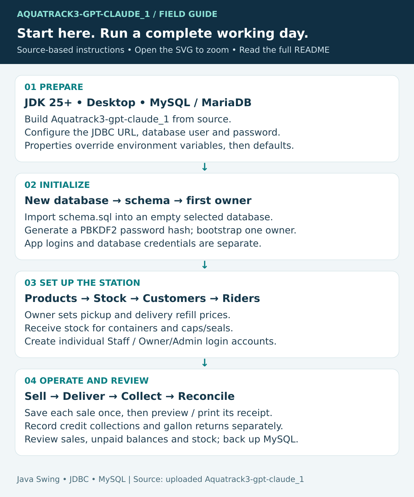
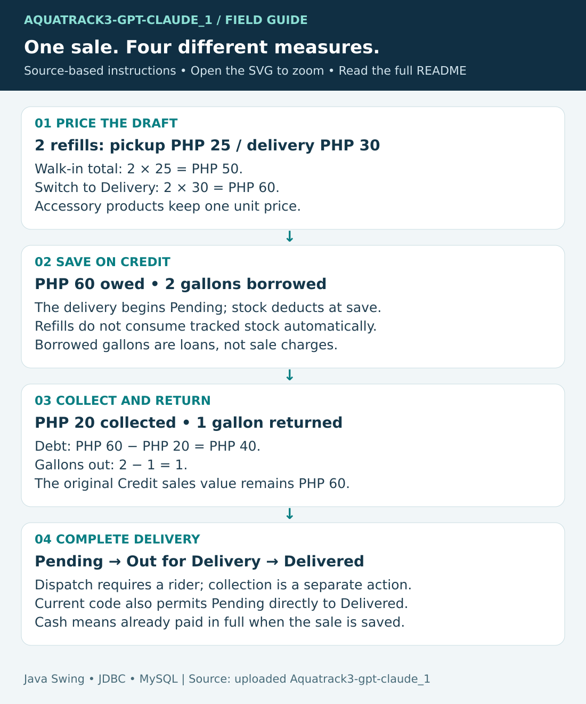
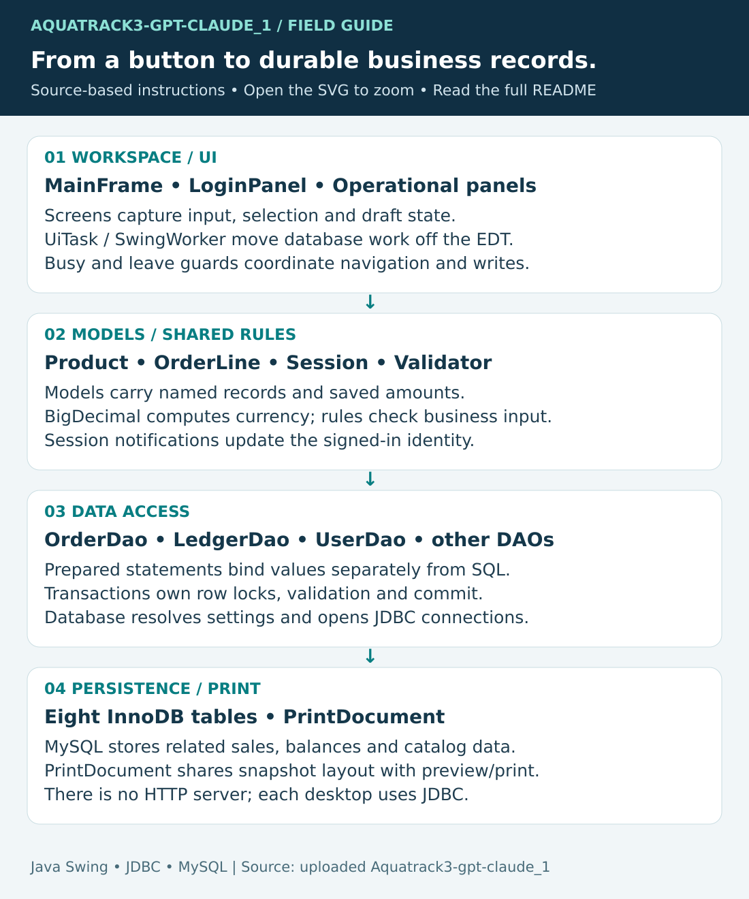

# AquaTrack — user and developer handbook

This guide documents **[Aquatrack3-gpt-claude_1](Aquatrack3-gpt-claude_1/)**, imported from the user's uploaded NetBeans project. It manages a water refilling station through Java Swing and MySQL: customers, pickup/delivery prices, sales, stock, riders, credit payments, returnable gallons, reports, and login accounts.

**[Download the illustrated PDF](docs/downloads/AquaTrack-Handbook.pdf)** for offline reading. On GitHub, open the file and choose **Download raw file**. The PDF includes this README, the architecture chapter and verification notes, with embedded vector graphics and searchable text.

**[How and why the code works](docs/architecture.md)** explains the implementation and its tradeoffs. **[Verification and import record](docs/verification.md)** distinguishes checks performed here from historical statements in the upload.

This is the `Aquatrack3-gpt-claude_1` project. The unrelated `GUI`, `LoginSystem`, and `LoginSystem_PT` folders are separate exercises. Their databases, credentials, and setup instructions do not apply here.

## Contents

- [Installation and first login](#installation-and-first-login)
- [First operating setup](#first-operating-setup)
- [Using every screen](#using-every-screen)
- [Worked example](#worked-example)
- [Daily checklist and backup](#daily-checklist-and-backup)
- [Troubleshooting](#troubleshooting)
- [Developer guide](#developer-guide)
- [Rebuild the learning materials](#rebuild-the-learning-materials)

## Visual learning map



| Graphic | Learn |
| --- | --- |
| [Start and operate](docs/images/01-start-and-operate.svg) | Prepare the workstation, first login, records and daily tasks. |
| [Sale and settlement](docs/images/02-sale-and-settlement.svg) | Pickup/delivery pricing, debt, collections and gallon counts. |
| [Architecture](docs/images/03-architecture.svg) | Screen → rules/models → DAO → JDBC → database. |
| [Transactions and printing](docs/images/04-transactions-and-printing.svg) | Safe saves, current prices, payment acknowledgement and print snapshots. |
| [Data model](docs/images/05-data-model.svg) | Eight tables, historical amounts and customer-level balances. |

## Installation and first login

### 1. Requirements and source

Use a **JDK 25 or newer**, a desktop session, and a MySQL-compatible server. The project targets Java 25; a Java 21 runtime cannot load these compiled classes. The bundled Connector/J driver is under `lib/`. The supplied database DDL comes from MariaDB; use a current MariaDB server (10.4+ supports the relevant constraints). MySQL 8.0.16+ is an alternative to validate in your environment. Live database compatibility was not exercised during this import.

Windows users can run MySQL/MariaDB through XAMPP. Apache is needed for phpMyAdmin, but AquaTrack connects directly to the database and does not need a web server. The application does not create a database or default login on startup.

```sh
git clone https://github.com/ideki4444/JAVA_GIU_SWING_DATABASE_PT.git
cd JAVA_GIU_SWING_DATABASE_PT
```

Before this import is merged, select `codex/aquatrack3-current-handbook`. Then enter `Aquatrack3-gpt-claude_1` and check `java -version` and `javac -version`. Alternatively download the branch ZIP from GitHub and extract it.

The import includes Java source, tests, required libraries, shared NetBeans files, helper scripts, and clean setup SQL. Local database dumps, backup archives, compiled output, and `nbproject/private` settings are omitted. Copying the source does not copy the live database.

### 2. Build

From `Aquatrack3-gpt-claude_1`, in Windows PowerShell:

```powershell
.\scripts\build.ps1
java -jar .\dist\Aquatrack3-gpt-claude.jar
```

Complete database setup before launching. To run the supplied automated suite use `.\scripts\build.ps1 -Test`; it currently stops at a known layout-test mismatch, documented in [verification](docs/verification.md). The build without `-Test` compiles and packages the application. This distinction avoids claiming the uploaded test suite is entirely green.

In NetBeans, open the project folder, choose JDK 25+ in project properties, confirm the local Connector/J library, and use Clean and Build. Its main class is `aquatrack.Main`. NetBeans names its output **`dist/Aquatrack3-gpt-claude_1.jar`**, while the PowerShell script names it **`dist/Aquatrack3-gpt-claude.jar`**. Use the filename produced by your chosen build path. Keep the accompanying `dist/lib` folder with a distributed JAR.

Linux/macOS compilation, from the same project directory:

```sh
mkdir -p build/package-classes
find src -name '*.java' > sources.txt
javac --release 25 -encoding UTF-8 -cp 'lib/*' -d build/package-classes @sources.txt
java -cp 'build/package-classes:lib/*' aquatrack.Main
```

Windows classpaths use `;` instead of `:`. Compilation requires no database connection. Swing windows require a graphical desktop.

### 3. Select the database connection

[`Database.java`](Aquatrack3-gpt-claude_1/src/aquatrack/db/Database.java) resolves settings in order: **JVM property → environment variable → default**. No source edit is required. An explicitly set empty value is still a configured value.

| Setting | JVM property | Environment variable | Default |
| --- | --- | --- | --- |
| URL | `aquatrack.db.url` | `AQUATRACK_DB_URL` | `jdbc:mysql://localhost:3306/aquatrack?serverTimezone=Asia/Manila&connectTimeout=5000&socketTimeout=15000` |
| Database user | `aquatrack.db.user` | `AQUATRACK_DB_USER` | `root` |
| Database password | `aquatrack.db.password` | `AQUATRACK_DB_PASSWORD` | Empty string |

PowerShell example, with credentials appropriate to your server:

```powershell
$env:AQUATRACK_DB_URL = 'jdbc:mysql://127.0.0.1:3306/aquatrack?serverTimezone=Asia/Manila&connectTimeout=5000&socketTimeout=15000'
$env:AQUATRACK_DB_USER = 'your_database_user'
$env:AQUATRACK_DB_PASSWORD = 'your_database_password'
java -jar .\dist\Aquatrack3-gpt-claude.jar
```

Use `export AQUATRACK_DB_USER='...'` and similar assignments in Bash. These affect processes launched from that shell; NetBeans needs matching settings in its launch environment or JVM options. Keep real passwords out of commits and shared command transcripts. `.env` files are not automatically loaded.

The database account is different from the AquaTrack login account. After schema creation, a dedicated database user generally needs SELECT/INSERT/UPDATE/DELETE on the application's database. Schema setup/migration needs additional DDL privileges. Desktop role controls do not replace control over database credentials.

### 4. Create a fresh database

The import supplies a **schema-only** version of the uploaded database definition. It contains eight tables and no station/customer data. Use a new, empty database; this script is not an upgrade script and intentionally fails if its tables already exist.

Start the MySQL client from the project directory:

```sh
mysql -u root -p
```

On Windows, if it is not on PATH:

```powershell
& 'C:\xampp\mysql\bin\mysql.exe' -u root -p
```

Then execute:

```sql
CREATE DATABASE aquatrack CHARACTER SET utf8mb4 COLLATE utf8mb4_unicode_ci;
USE aquatrack;
SOURCE sql/schema.sql;
SHOW TABLES;
```

If `aquatrack` already exists, use a new name and update the JDBC URL accordingly. Do not drop an existing database to follow this tutorial. The expected tables are `users`, `customers`, `products`, `delivery_staff`, `orders`, `order_items`, `payments`, and `container_ledger`.

In phpMyAdmin, create/select the empty database first and import `schema.sql`. `SOURCE` is a MySQL command-line instruction, not a SQL statement for phpMyAdmin.

### 5. Bootstrap the first owner

There is no built-in login for a fresh installation. Generate a hash using the compiled project's helper:

```sh
java -cp build/package-classes aquatrack.util.PasswordUtil 'your-chosen-password'
```

Choose at least six characters; use a strong password for real use. NetBeans-only builds use `build/classes` instead. The command-line argument can remain in shell history. Copy the complete `pbkdf2_sha256$65536$...` result. In one MySQL session:

```sql
USE aquatrack;
SET @owner_username = 'station_owner';
SET @owner_full_name = 'Your Name';
SET @owner_password_hash = 'PASTE_COMPLETE_GENERATED_HASH';
SOURCE sql/bootstrap-owner.sql;
```

The result must say **Owner account created**. The script refuses when `users` already contains records or the values fail its basic checks. It checks the hash format, not whether you remember the password; use the actual helper output. Run this once during exclusive first-time setup. For phpMyAdmin, submit the SET statements and script contents together so variables share a session. Escape an apostrophe in SQL text by doubling it.

Launch the app, enter your chosen username and original plaintext password, and sign in. Create subsequent accounts through Accounts.

### 6. Existing installations and optional demonstrations

For an existing compatible pre-delivery-price database, back it up and close running clients before using `scripts/migrate-prices.ps1 -DatabaseName your_database`. It requires the PowerShell-built JAR, local MySQL tools, and their own authentication configuration. It does not automatically use the application's environment password. The script takes a backup, applies `sql/001_delivery_prices.sql`, and compares existing product/sales/payment/ledger records. Failure preserves the backup for inspection; it does not automatically restore over data.

The migration was recovered from the appended migration in the uploaded SQL. It adds nullable `delivery_price` when missing, fills only null refill rates from pickup prices (including archived refills), and adds a nonnegative check. Re-running preserves configured prices. Do not run the fresh schema against an existing installation.

For disposable training data after building on Windows:

```powershell
.\scripts\create-demo.ps1 -DatabaseName aquatrack_demo_training01
.\scripts\run-demo.ps1 -DatabaseName aquatrack_demo_training01
```

The creation helper requires local MySQL tools, refuses an existing database, and prints the launch command. It uses the schema-only baseline and migration, then `scripts/DemoSeed.java`. Its intentionally synthetic accounts are `demo_owner` / `DemoOwner25!`, `demo_manager` / `DemoManager25!`, and `demo_staff` / `DemoStaff25!`. A username containing “manager” is not a third application role: the only roles are Staff and Owner/Admin. These fixtures are for isolated training, not live deployment. A database mentioned as already prepared in the uploaded notes does not exist automatically on your computer.

## First operating setup

1. Sign in as Owner/Admin and add refill products with pickup and delivery prices in **Products & Prices**.
2. Add sellable Container and Cap/Seal products. Receive their opening quantities through **Inventory**.
3. Add customer names, addresses and mobile numbers. Even a walk-in sale needs a customer record.
4. Add riders through **Deliveries** if you offer delivery.
5. Create individual staff accounts through **Accounts**.
6. Practice the worked example below on an isolated database before real sales. Saved orders have no cancellation/refund workflow in this UI.

## Using every screen

### Navigation, sign-in and roles

The application opens a workspace containing sign-in and the operational screens. Enter both credentials. An unknown/inactive username reports **Account doesn't exist**, clearing both fields. A wrong password reports **Password is incorrect**, preserving the username and clearing the password. Successful authentication reports **Log-in Successfully**. These are the current source's behaviors, even where older uploaded notes describe generic rejection.

Screen queries and writes use background workers. While an operation is pending, controls and navigation are guarded; wait for completion instead of repeatedly clicking Save or exiting. Reopening a screen refreshes its records. Scroll the workspace/table when small windows or display scaling hide controls. Log out ends the session; unsaved drafts and the latest-receipt pointer are not durable across sessions.

| Task | Staff | Owner/Admin |
| --- | --- | --- |
| Dashboard, orders, deliveries, receipts | Yes | Yes |
| Add/edit customers | Yes | Yes |
| Record payments and gallon movements | Yes | Yes |
| Receive stock | Yes | Yes |
| Edit product catalog/prices and reorder levels | No | Yes |
| Archive/restore/delete customers | No | Yes |
| Reports and account management | No | Yes |

Owner controls are partly UI-level. Account mutations additionally recheck the acting owner's current database record. This is still a desktop JDBC system, not a server authorization service.

### Customers

Choose New, enter full name, address and contact number, then Save. Select a row to edit it. Search and active/archive filters help locate records. A mobile number must contain 11 digits starting with `09`; names and addresses are required and limited to 100 and 255 characters respectively.

The form checks duplicate names/contact numbers; the database also has a composite unique key on `(full_name, contact_no)`. Owners can Archive to hide a customer while preserving history, Restore to make them operational again, or Delete a customer with no dependent history. Settle outstanding obligations before archiving, or restore the customer to record further payments/returns. The Unpaid balances report includes archived debtors.

### Products & Prices

Choose **New product**, name and category, then enter **Pickup / unit price**. For a Refill, also enter **Delivery refill price**. Enter **Low-stock alert at** for tracked products and Save. Values must fit the application's money/count validation; monetary inputs are nonnegative with at most two meaningful decimal places. Refill stock is untracked and its reorder threshold is zero.

| Category | Price selection | Inventory |
| --- | --- | --- |
| Refill | Pickup rate for Walk-in; delivery rate for Delivery | Not deducted; made on demand |
| Container | Single unit price | Sold quantity deducted on order save |
| Cap/Seal | Single unit price | Sold quantity deducted on order save |

Search by name/category; searches are debounced and treat wildcard characters literally. **Current products**, **Archived**, and **All** control visibility. Status distinguishes Available, In Stock, Low Stock, Out of Stock and Archived. Select a product to edit. Filtering can hide the selected row without discarding the edit; check the form's record identity before saving.

Archive stops new use without removing history; Restore reverses that. Delete is restricted for products already used by orders. Product names are unique in the database. Create a distinct product rather than casually changing an established product's business meaning/category. A refill does not automatically consume a cap or sellable container; include those as sale lines if sold.

### Inventory

Search active stock-tracked products, select an item, enter a positive whole number in Stock received, and choose Add to stock. This increments the existing quantity. Owners can change the low-stock alert threshold. Stock at or below that threshold is low; zero is out of stock. Refills do not appear here. There is no general stock-writeoff/adjustment-history module; ordinary deductions occur when sales are saved, including deliveries still pending.

### New Order

1. Choose an active customer and **Walk-in (served now)** or **Delivery (rider assigned later)**.
2. Choose **Cash, paid now** only when fully paid. Choose **Credit, add to balance** for money still owed, including cash-on-delivery before collection.
3. Enter gallons borrowed/returned (0–500 in each spinner), or leave zero.
4. Select a product, enter Qty (1–999 per addition), and choose Add to order. Adding the same product combines its quantity.
5. Review every line and total. Remove item removes the selected draft line. Clear order resets the draft. Refresh choices reloads current customer/product choices.
6. Changing Walk-in/Delivery reprices refill lines. Review the updated total; accessories keep their single price.
7. Choose **Save and preview receipt** once. Wait for the result, then print or close the preview.

The database rechecks customer activity, product activity, prices and stock. If another workstation changed a price, the transaction rolls back and the draft receives current prices for another deliberate Save. Insufficient stock or excessive returns also prevent the save. A return may not exceed existing gallons out plus gallons borrowed in the same sale.

Walk-in orders start Delivered; delivery orders start Pending. Order header, item rows, tracked stock deductions and order-linked gallon movements commit together. Gallon loans are not a charge and do not change sellable-container stock.

After a successful save, the draft is cleared and the order ID is retained for receipt access. **View last receipt** becomes the saved-order reference; a receipt-loading failure can be retried by ID. Do not re-enter the sale because printing failed. The app has no general historical-receipt search, saved-order edit, cancellation, refund, discount, tax, cash tender/change or split-payment field. For a part-payment, create the full Credit sale and record the amount received separately.



### Deliveries

Save a Delivery order first. In Deliveries, select it, add/select a rider and choose Assign rider. Choose Out for delivery at dispatch, then Mark delivered on completion. The open-only filter excludes Delivered orders; disable it to include completed deliveries.

Dispatch requires Pending status and a rider. Delivered orders cannot change riders. The implementation also permits **Pending directly to Delivered without a rider**; the full dispatch sequence is an operating recommendation, not a strict invariant. A stale status update is rejected and refreshed. Delivery completion neither collects payment nor changes Credit to Cash. Rider records are separate from user logins; the UI does not provide full rider editing/deactivation management.

### Containers & Balances

The default **Only customers with gallons out or a balance** filter hides settled customers. Uncheck it to find a new customer's first standalone loan. Archived customers remain excluded; restore them through Customers if needed.

Select a customer and enter **Payment received (PHP)**, then Record payment. The amount must be positive and no larger than the current unpaid balance. The DAO locks the customer, recalculates the balance, inserts the payment and commits before returning an acknowledgement. The confirmation gives payment reference, amount, customer, previous and remaining balance; zero is Fully paid. If a subsequent refresh fails, the app distinguishes that from a failed payment. Keep the reference and refresh rather than recording the same collection twice.

For a movement outside a sale, enter the gallon count and choose Record gallons returned or Record gallons borrowed. Counts must be positive; returns cannot exceed the current outstanding count. These operations also check/write under a customer lock. Payments apply to the customer's combined debt, not to a selected invoice.

```text
Unpaid = total of Credit orders − recorded payments
Gallons out = all Borrowed quantities − all Returned quantities
```

The screen totals cover active customers; the Dashboard's ledger total and archived-inclusive debt report can have a broader scope. There is no payment/ledger reversal or full movement-history editor in this UI.

### Dashboard and Reports

Dashboard shows today's order value, open deliveries, gallons out and low-stock products, plus the seven-day sales chart and recent orders. Sales include Cash, Credit and pending deliveries on the date created. They are not cash collected or profit. The chart initially occupies 45% of the lower split; manual divider adjustments are retained during resizing.

Owners can choose Daily sales, Monthly sales, Best customers or Unpaid balances in Reports. Daily uses year/month and omits days without sales; Monthly uses year and fills zero-sales months; Best customers ranks all-time order value; Unpaid balances shows current debt, including archived customers. Date controls do not filter the latter two. Print is available for the successfully loaded snapshot. Changing selection while loading supersedes an older result.

A later credit payment reduces debt but does not convert the original order to Cash or add a second sale. Reconcile actual cash collections separately; there is no full cash-drawer closeout or profit module.

### Receipt and report previews

Sales receipts use an **80 mm roll** with length fitted to the sale, wrapped details and black monospaced text. Preview offers Zoom, minus/plus, Print and Close. It deliberately lacks paper orientation and Previous/Next controls. Select a matching thermal-printer driver and adequate form length; actual feed/cutting behavior depends on hardware and has not been verified here.

Reports use **A4** with portrait/landscape selection and page navigation. Preview and print use the same document snapshot so an asynchronous screen refresh does not silently replace the printed data. Print opens the OS print dialog. A PDF printer is an OS feature; the application has no separate built-in PDF-export workflow. Closing the preview or canceling printing does not undo or repeat a sale.

Saved prices and amounts remain historical. Customer/product descriptions are read from current database records when reloading a receipt, so later edits can change its wording. Keep an external printed/PDF record when an exact historical presentation is needed.

### Accounts

Owner/Admin opens Accounts. Choose New account, enter a unique username (3–50 letters, digits or underscores), full name (up to 100 characters), Staff or Owner/Admin role, initial password (at least six characters), and Account can sign in, then Create account.

Selecting a row fills the editing form. Save changes updates username/name/role/activity **without changing the password**. Reset password is a separate action/dialog. Save/Discard/Cancel protects unfinished edits when leaving or changing selection. Editing your own details refreshes the session's displayed identity.

Account writes lock the user rows in ID order and recheck the actor's active owner status. You cannot deactivate or demote your own signed-in account, and at least one active owner must remain. Username and normalized full-name duplicates are checked. There is no public registration/email recovery. Disabling a different user blocks later sign-in; not every business operation continuously revalidates all existing sessions.

## Worked example

Use a fresh training customer, no existing debt or gallons out. Create a refill at PHP 25 pickup and PHP 30 delivery.

1. Add two refills to a Walk-in draft: total PHP 50.
2. Switch to Delivery: total becomes PHP 60. Choose Credit, borrow two gallons, return zero, and save.
3. Assign a rider, dispatch and complete delivery. Debt remains PHP 60 until collection is entered.
4. Record PHP 20 received and one gallon returned. Debt becomes PHP 40; gallons out becomes one.
5. Reports retain PHP 60 of original Credit sales. Collection does not create another sale.
6. If selling caps or a container too, add explicit product lines: those affect stock and sale value independently of loan counts.

## Daily checklist and backup

| When | Check |
| --- | --- |
| Opening | Database running; correct workstation configuration; individual login; prices and low stock reviewed. |
| Each sale | Correct customer, fulfillment, payment type, prices, quantities and loans; save once; keep the order reference. |
| Dispatch | Rider assigned, progress updated; collections recorded separately. |
| Closing | Review pending deliveries, sales, unpaid balances, stock and gallons; reconcile cash separately; back up and log out. |

The live data is in MySQL, not GitHub. Stop data entry during backup/restore. Use an authorized database account:

```sh
mysqldump -u root -p --single-transaction --databases aquatrack --result-file=aquatrack-backup.sql
```

`mariadb-dump` may replace `mysqldump`. Store backups privately outside Git. Test restoration on an isolated server before replacing live data. In a MySQL client, `SOURCE /path/to/aquatrack-backup.sql;` loads a dump; use forward slashes on Windows. A dump can replace tables, so preserve the destination data first. Back up the application configuration and matching program version as well.

## Troubleshooting

| Symptom | Action |
| --- | --- |
| `javac` absent / release 25 unsupported | Install a full JDK 25+, update PATH, reopen the terminal. |
| Unsupported class version | Launch with Java 25+ matching the source target. |
| `build.ps1 -Test` stops on width 400 versus 420 | Known uploaded test/source mismatch; see verification. Plain build packages without running tests. |
| Driver missing | Keep Connector/J on the classpath or the packaged JAR's `dist/lib` beside it. |
| Connection failure / access denied | Check DB service, host/port, effective property/environment values and database grants. App credentials are separate. |
| Table/`delivery_price` absent | Use the correct database; import clean schema only into an empty DB, or apply the compatible migration to an older schema after backup. |
| No account found | Bootstrap a fresh installation or check active status; enter plaintext password, not its stored hash. |
| Product not available | Restore archived items; refresh choices; receive tracked stock before selling. |
| Customer not in balance list | Disable open-items-only filter; restore an archived customer first. |
| Price changed | Review newly priced draft and save deliberately again. The previous attempt rolled back. |
| Saved payment/order but refresh/print failed | Use saved reference and refresh/retry preview; avoid duplicate entry. |
| Controls seem inaccessible | Scroll workspace/table; wait for pending operations; check display scaling. |
| Receipt clipped by printer | Use matching 80 mm driver/form length and test hardware; report orientation controls apply to reports only. |

For lost-owner recovery, a database administrator can generate a new PasswordUtil hash and update the exact intended user's hash/activity after verifying their identity and affected row. The first-owner script deliberately does not overwrite an existing account.

## Developer guide



Read the [architecture chapter](docs/architecture.md) for class responsibilities, data relationships, formulas, row-lock transactions, session/UI coordination, printing and extension points. “Why” explains engineering benefits inferred from the implementation, not undocumented intentions of the original author.

The [supplied usability protocol](Aquatrack3-gpt-claude_1/docs/usability-evaluation.md) and blank observations CSV are preserved as historical reference notes. Referenced survey documents, private backups and previously prepared databases are not included; the notes do not establish measured user-study results.

No runtime Java files were changed for this import. Clean SQL and documentation were added; historical claims in the uploaded README are not treated as proof of a current passing test run. See [verification](docs/verification.md).

## Rebuild the learning materials

The SVG generator uses Python's standard library. The PDF exporter requires Python 3.10+, packages in [requirements.txt](docs/tools/requirements.txt), and WeasyPrint's native Pango/Fontconfig libraries. See [WeasyPrint installation](https://doc.courtbouillon.org/weasyprint/stable/first_steps.html) for your OS. These are documentation tools, not Java runtime dependencies.

From the repository root on Linux/macOS:

```sh
python3 docs/tools/build_infographics.py
python3 -m venv .venv-docs
.venv-docs/bin/python -m pip install -r docs/tools/requirements.txt
.venv-docs/bin/python docs/tools/build_handbook.py
```

On Windows use `py -3` to create the environment and `.venv-docs\Scripts\python.exe` for the Python commands after installing native libraries. Edit the Markdown and diagram generator, rebuild, then commit the text, SVGs and PDF together. Inspect dense tables, all figures and links before publishing.
