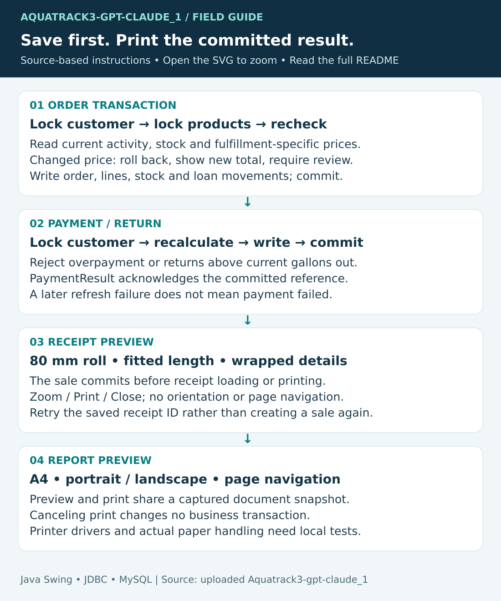

# How and why this AquaTrack project works

This chapter describes the uploaded **Aquatrack3-gpt-claude_1** code. Read the [README](../README.md) for installation and operation. Statements of behavior come from source; explanations of benefits are engineering interpretations. Proposed extensions are not existing features.

## 1. Model the business before the screens

A sale, payment, loaned gallon and delivery milestone can happen on different days. The program records them separately. Orders answer what was sold; payments reduce customer debt; container movements track what customers must return; delivery status records fulfillment. Selling a new container is distinct from lending a returnable gallon.

This separation explains why marking Delivered does not collect money, why a Credit sale remains Credit after collection, and why a returned gallon does not increase sellable product stock. It also means there is no invoice-specific payment allocation: payments belong to a customer.

## 2. Runtime architecture

`Main` starts Swing. `MainFrame` coordinates the workspace, login, navigation and session-ending actions. `LoginFrame` is a compatibility wrapper and `LoginPanel` handles credential input/authentication. Screen actions invoke DAOs, which open JDBC connections through `Database`. There is no HTTP backend, ORM or separate application server.

| Package | Responsibility | Reason and tradeoff |
| --- | --- | --- |
| `ui` | Widgets, action listeners, state, feedback, background tasks and previews | Tasks stay close to their controls, but panels contain application coordination as well as presentation. |
| `model` | Typed users, products, customers, orders and calculated summaries | Named values are clearer than arbitrary result-array positions. They are ordinary Java objects, not automatically persisted entities. |
| `dao` | Parameterized SQL, mapping, transaction boundaries | Keeps queries out of forms and allows connection test doubles. Different operations still have different validation guarantees. |
| `db` | Connection settings and small JDBC helpers | Centralizes credentials and resource handling without a connection pool. |
| `util` | Validation, money rules, delivery rules, hashing, sessions, ranking and print documents | Shared rules reduce duplication and can be tested independently of a real database. |

## 3. Source map

All links below point to the imported source tree. Read the class with its corresponding screen rather than assuming a class name represents an entire service layer.

| Class | Responsibility |
| --- | --- |
| [Main](../Aquatrack3-gpt-claude_1/src/aquatrack/Main.java) | Launches the Swing application. |
| [CustomerDao](../Aquatrack3-gpt-claude_1/src/aquatrack/dao/CustomerDao.java) | Search, edit, archive and history-aware customer deletion. |
| [DeliveryStaffDao](../Aquatrack3-gpt-claude_1/src/aquatrack/dao/DeliveryStaffDao.java) | Rider records and active-rider lookup. |
| [LedgerDao](../Aquatrack3-gpt-claude_1/src/aquatrack/dao/LedgerDao.java) | Derived balances, locked payments and standalone container movements; committed PaymentResult. |
| [OrderDao](../Aquatrack3-gpt-claude_1/src/aquatrack/dao/OrderDao.java) | Atomic sale creation, receipt lookup, rider assignment and conditional delivery updates. |
| [ProductDao](../Aquatrack3-gpt-claude_1/src/aquatrack/dao/ProductDao.java) | Catalog/search, pickup and delivery prices, stock increments and thresholds. |
| [ReportDao](../Aquatrack3-gpt-claude_1/src/aquatrack/dao/ReportDao.java) | Read-only sales aggregates and dashboard data. |
| [UserDao](../Aquatrack3-gpt-claude_1/src/aquatrack/dao/UserDao.java) | Account profile and password mutations with owner authorization and ordered locks. |
| [Database](../Aquatrack3-gpt-claude_1/src/aquatrack/db/Database.java) | Resolves JVM/environment/default settings and creates JDBC connections. |
| [Customer](../Aquatrack3-gpt-claude_1/src/aquatrack/model/Customer.java) | Customer identity/contact/archive state. |
| [CustomerAccount](../Aquatrack3-gpt-claude_1/src/aquatrack/model/CustomerAccount.java) | Calculated gallons out and unpaid balance. |
| [CustomerOrder](../Aquatrack3-gpt-claude_1/src/aquatrack/model/CustomerOrder.java) | Joined order header, lines, rider and gallon details. |
| [CustomerTotal](../Aquatrack3-gpt-claude_1/src/aquatrack/model/CustomerTotal.java) | Accumulator for customer ranking. |
| [DeliveryStaff](../Aquatrack3-gpt-claude_1/src/aquatrack/model/DeliveryStaff.java) | Rider identity independent of login accounts. |
| [OrderLine](../Aquatrack3-gpt-claude_1/src/aquatrack/model/OrderLine.java) | Quantity, price and line total snapshot. |
| [Product](../Aquatrack3-gpt-claude_1/src/aquatrack/model/Product.java) | Category, pickup/delivery rates, stock and availability predicates. |
| [User](../Aquatrack3-gpt-claude_1/src/aquatrack/model/User.java) | Login identity, role, activity and password hash. |
| [AccountsPanel](../Aquatrack3-gpt-claude_1/src/aquatrack/ui/AccountsPanel.java) | Create/edit accounts, dirty-form protection and independent password reset. |
| [ContainersPanel](../Aquatrack3-gpt-claude_1/src/aquatrack/ui/ContainersPanel.java) | Payments, acknowledgement and borrowed/returned gallon entry. |
| [CustomersPanel](../Aquatrack3-gpt-claude_1/src/aquatrack/ui/CustomersPanel.java) | Customer forms, searching and archive actions. |
| [DashboardPanel](../Aquatrack3-gpt-claude_1/src/aquatrack/ui/DashboardPanel.java) | Metrics, recent orders and seven-day chart. |
| [DeliveriesPanel](../Aquatrack3-gpt-claude_1/src/aquatrack/ui/DeliveriesPanel.java) | Riders, dispatch and completion controls. |
| [InventoryPanel](../Aquatrack3-gpt-claude_1/src/aquatrack/ui/InventoryPanel.java) | Search, receive stock and update low-stock thresholds. |
| [LoginAuthenticator](../Aquatrack3-gpt-claude_1/src/aquatrack/ui/LoginAuthenticator.java) | Testable credential outcome logic. |
| [LoginFrame](../Aquatrack3-gpt-claude_1/src/aquatrack/ui/LoginFrame.java) | Compatibility window around login UI. |
| [LoginPanel](../Aquatrack3-gpt-claude_1/src/aquatrack/ui/LoginPanel.java) | Credential UI and asynchronous authentication. |
| [MainFrame](../Aquatrack3-gpt-claude_1/src/aquatrack/ui/MainFrame.java) | Workspace navigation, session display and pending-operation guards. |
| [NavIcon](../Aquatrack3-gpt-claude_1/src/aquatrack/ui/NavIcon.java) | Navigation icon drawing. |
| [OrderPanel](../Aquatrack3-gpt-claude_1/src/aquatrack/ui/OrderPanel.java) | Draft cart, repricing, save and receipt retry. |
| [PrintPreviewDialog](../Aquatrack3-gpt-claude_1/src/aquatrack/ui/PrintPreviewDialog.java) | Document rendering, zoom, page format and printing. |
| [PrintPreviewToolbar](../Aquatrack3-gpt-claude_1/src/aquatrack/ui/PrintPreviewToolbar.java) | Shared preview controls. |
| [ProductsPanel](../Aquatrack3-gpt-claude_1/src/aquatrack/ui/ProductsPanel.java) | Search and editing for catalog, category and both refill rates. |
| [ReceiptDialog](../Aquatrack3-gpt-claude_1/src/aquatrack/ui/ReceiptDialog.java) | Receipt-specific preview entry point. |
| [ReportsPanel](../Aquatrack3-gpt-claude_1/src/aquatrack/ui/ReportsPanel.java) | Background reports, date selection and captured print content. |
| [UiKit](../Aquatrack3-gpt-claude_1/src/aquatrack/ui/UiKit.java) | Shared theme, layouts, tables, widgets and feedback. |
| [UiTask](../Aquatrack3-gpt-claude_1/src/aquatrack/ui/UiTask.java) | Background execution and EDT completion wrapper. |
| [WaterArtwork](../Aquatrack3-gpt-claude_1/src/aquatrack/ui/WaterArtwork.java) | Java2D sign-in illustration. |
| [WorkspacePanel](../Aquatrack3-gpt-claude_1/src/aquatrack/ui/WorkspacePanel.java) | Scrollable host for operational content. |
| [DeliveryRules](../Aquatrack3-gpt-claude_1/src/aquatrack/util/DeliveryRules.java) | Allowed delivery actions and user-facing rejection messages. |
| [Fmt](../Aquatrack3-gpt-claude_1/src/aquatrack/util/Fmt.java) | Currency and date formatting. |
| [OrderRules](../Aquatrack3-gpt-claude_1/src/aquatrack/util/OrderRules.java) | Stock/gallon checks and total addition. |
| [PasswordUtil](../Aquatrack3-gpt-claude_1/src/aquatrack/util/PasswordUtil.java) | Salted PBKDF2 hash generation/verification and setup CLI. |
| [PrintDocument](../Aquatrack3-gpt-claude_1/src/aquatrack/util/PrintDocument.java) | Printable document model, pagination, layout and rendering shared with preview. |
| [Ranking](../Aquatrack3-gpt-claude_1/src/aquatrack/util/Ranking.java) | Customer grouping and descending spending ranking. |
| [Receipt](../Aquatrack3-gpt-claude_1/src/aquatrack/util/Receipt.java) | Formats receipt content from a saved order. |
| [Session](../Aquatrack3-gpt-claude_1/src/aquatrack/util/Session.java) | Current user and EDT-dispatched identity-change notifications. |
| [Validator](../Aquatrack3-gpt-claude_1/src/aquatrack/util/Validator.java) | Required text, money, mobile and integer checks. |

## 4. Database relationships and constraints


| Table | Stored facts and relationships |
| --- | --- |
| `users` | Primary key user_id; unique username; PBKDF2 hash; full name; Owner/Admin or Staff; active flag. Orders reference their creator. |
| `customers` | customer_id; name/address/contact; archived flag; created_at; composite unique name/contact key. Parent of orders, payments and movements. |
| `products` | product_id; unique product name; category; decimal unit_price and nullable delivery_price; stock, threshold and activity. Referenced by order items. |
| `delivery_staff` | staff_id; rider name/contact/activity. Orders may have no rider initially. |
| `orders` | order_id; order_date; customer; order/payment type; decimal total; status; optional rider; creator user. |
| `order_items` | item_id; order/product keys; quantity; saved unit price and line total. Header-to-items FK uses ON DELETE CASCADE. |
| `payments` | payment_id; customer; positive amount; paid_at. No order_id or collecting-user column. |
| `container_ledger` | ledger_id; customer; Borrowed/Returned; positive quantity; moved_at; optional order_id. Standalone movements have no order link. |

The supplied SQL uses InnoDB and utf8mb4. Prices and monetary totals are DECIMAL(10,2); the application cannot store arbitrarily large order totals even if Java can calculate them. Quantity/amount checks and foreign keys protect the declared relationships, but the database does not independently recompute every order total from line items.

Normalization avoids copying customer details into each sale. Historical unit prices and totals are intentional snapshots; customer names/address and product names remain live references. That is why old receipts retain monetary values but may show edited descriptions.

The composite customer unique key is not equivalent to separate uniqueness of name and phone; the UI performs additional duplicate checks. Product names and usernames have individual unique constraints. Account full-name uniqueness is enforced by account mutation logic.

The clean schema was extracted from this upload's DDL, without INSERT data, database selection or auto-increment history. It is a fresh-install script, not an automatic migration framework. A schema-only pre-delivery-price baseline supports the supplied demo helper; the appended migration was extracted into its expected filename.

## 5. Formulas and price selection

```text
Refill rate = pickup unit_price for Walk-in
            = delivery_price for Delivery (fallback to pickup if null)
Accessory rate = unit_price for either order type
Line total = quantity × selected rate
Sale total = sum(line totals)
Unpaid balance = sum(Credit order totals) − sum(customer payments)
Gallons out = sum(Borrowed quantities) − sum(Returned quantities)
Stock after sale = current stock − quantity sold (tracked categories only)
Low stock = active AND tracked AND stock <= threshold
```

`Product.priceForOrderType` centralizes fulfillment-dependent price choice. `OrderLine.priced` and `OrderRules.total` use BigDecimal, avoiding binary floating-point error in financial arithmetic. SQL stores matching decimals. Chart geometry may use floating point without changing the saved accounting values.

For two refills at PHP 25 pickup/PHP 30 delivery, switching a draft from Walk-in to Delivery changes PHP 50 to PHP 60. A PHP 20 later payment leaves PHP 40 debt while original Credit sales remain PHP 60. Borrow two/return one leaves one gallon out. These are independent measures.

Sales reporting groups orders by their creation date; it includes uncollected Credit and pending deliveries. Database timestamps and Java local dates both participate in reporting, so keep workstation/server clocks and the configured Asia/Manila timezone consistent.

## 6. Order transaction: from click to committed ID



1. `OrderPanel` validates customer/cart/spinner input and captures the requested sale. UI stock checks provide quick feedback, not final authority.
2. `OrderDao.placeOrder` opens one connection, disables autocommit and locks the active customer with SELECT FOR UPDATE.
3. Each product is locked and reread. The DAO checks current activity, positive quantity and available stock, selects the current fulfillment-specific rate and deducts tracked stock on the transaction connection.
4. If any price differs from the reviewed draft, PricesChangedException carries updated lines. The transaction rolls back its writes. The UI shows revised values and requires a deliberate second Save.
5. The DAO checks returned gallons against previous outstanding plus newly borrowed. It inserts the header, item lines and nonzero order-related movements, then commits once and returns the generated order ID.
6. The UI clears the committed draft and retains that ID before receipt lookup. Loading/printing is subsequent work. A preview failure cannot undo the sale; retrying its ID avoids an accidental second order.

Why lock rows? Two clients may both see old stock. The second transaction must wait and then check the remaining quantity rather than selling the same units. The same customer lock coordinates order-related gallon checks with standalone movements and payments.

Locks are not a complete distributed retry protocol. Overlapping carts can acquire product locks in different orders and deadlock. A lost connection around commit can leave the client uncertain whether a sale committed. There is no general idempotency key or automatic refund flow; inspect persisted records before manually repeating an ambiguous save.

## 7. Payments and container movements

`LedgerDao.recordPayment` validates positive decimal money, begins a transaction, locks the active customer and recalculates their debt using that same connection. It rejects overpayment, inserts the payment, obtains a reference and database timestamp, constructs an immutable PaymentResult, and returns it only after commit.

`recordMovement` validates Borrowed/Returned and positive quantity, takes the same customer lock and checks the latest balance before inserting. Returns cannot exceed the count outstanding. These are transactional read/check/write operations in this project; they must not be described as the unlocked paths of an earlier version.

A customer-row lock serializes cooperating application writers. Direct SQL that bypasses this protocol can still violate aggregate rules. There is no table-wide immutable audit trail of who collected each payment because those rows do not contain a collector user ID.

## 8. Accounts, passwords and session identity

`UserDao.save` and `resetPassword` lock user records in user_id order. They revalidate that the acting user is an active owner, reject duplicate usernames/normalized names, protect the current owner from self-deactivation/demotion, and retain at least one active owner. Deterministic locking reduces competing-owner races and avoids relying only on stale enabled UI controls.

Profile editing deliberately omits password changes. Password reset is independent, preventing an innocent name edit from replacing a credential. The panel's dirty-state choices Save/Discard/Cancel protect unfinished work. After saving the signed-in user's details, `Session.refresh` updates only that same still-active session identity and notifies UI listeners on the EDT.

PasswordUtil uses a random 16-byte salt, 65,536 PBKDF2-HMAC-SHA256 iterations and a 256-bit derived key. The stored format includes algorithm, iteration count, salt and hash. This describes the current implementation, not a guarantee that its work factor meets every deployment's contemporary security requirements.

There is no universal per-operation session revocation service. Account administration rechecks its actor in the DAO, while other business permissions rely on desktop/session controls. Direct database access remains a separate trust boundary.

## 9. Background work and navigation

Swing components must be updated on the event dispatch thread. UiTask/SwingWorker execute database work in the background and marshal completion back to that thread. Busy flags disable relevant actions, and screen contracts expose pending operations. Navigation, logout and exit guards prevent a user abandoning an in-progress write as though it never happened.

Search/report generation can finish out of order. The UI uses current request state to avoid showing an old response as the newest selection. Products and Inventory debounce search to avoid querying on every keystroke and bind literal search text. Record IDs, rather than row positions alone, preserve selection across refreshed/filtered tables.

This is explicit application coordination rather than a reactive framework. A new screen must implement the same refresh/busy/leave conventions or it can reintroduce duplicate writes and stale UI state.

## 10. Delivery, reports and printing

DeliveryRules allows dispatch only from Pending with a rider, and rejects changing a delivered order's rider. Completion only rejects an already Delivered state, so Pending → Delivered is also possible without dispatch. Conditional status updates compare the expected old status to detect stale screens. There is no payment side effect.

ReportDao performs sales queries; Ranking accumulates totals per customer in a HashMap and sorts them descending. For n rows and c customers, grouping is expected O(n), sorting O(c log c), with the loaded rows also consuming memory. SQL aggregation/pagination would be a scaling option, not an existing architecture change.

PrintDocument provides a captured document model and shared rendering used by preview and Printable. This avoids maintaining two layouts that drift apart. Receipt documents are 80 mm continuous rolls with fitted length and wrapped text. Report documents use A4 pagination and orientation. The preview toolbar exposes only controls meaningful for that document type. Zoom changes viewing scale rather than recording a new sale.

The printed snapshot is stable even when a screen's underlying data later refreshes. Reloading a past order still joins present-day descriptive records, however; exact historical wording would require additional stored snapshots.

## 11. Extension map and limitations

| Change | Trace together |
| --- | --- |
| Add tax/discount/delivery fee | Order UI, rules, stored snapshots, schema migration, reports and receipt totals/rounding. |
| Strict delivery progression | DeliveryRules plus transactional DAO status/rider checks and concurrency tests. |
| Cancel/refund an order | Explicit reversal records for stock, payments and loan movements; authorization and double-reversal protection. |
| Invoice-based collections | Payment allocation schema and accounting rules, UI selection and report semantics. |
| Stronger centralized authorization | A trusted service/API boundary; migrate validation out of untrusted desktop clients. |
| Historical receipt wording | Order/customer/product snapshot columns, old-data policy and receipt lookup. |
| Larger deployments | Connection management, indexed query plans, pagination, SQL ranking and concurrency/load tests. |
| New screen | MainFrame registration, refresh, pending-operation and dirty-form contracts, role visibility and scaling checks. |

Read source in this order: Main → MainFrame/LoginPanel → Database → one simple model/DAO/panel → Product/OrderRules/OrderDao → LedgerDao/UserDao → PrintDocument and ReportsPanel → the corresponding tests. A feature is complete only when its input, persisted meaning, calculations, reports and printed representation agree.
