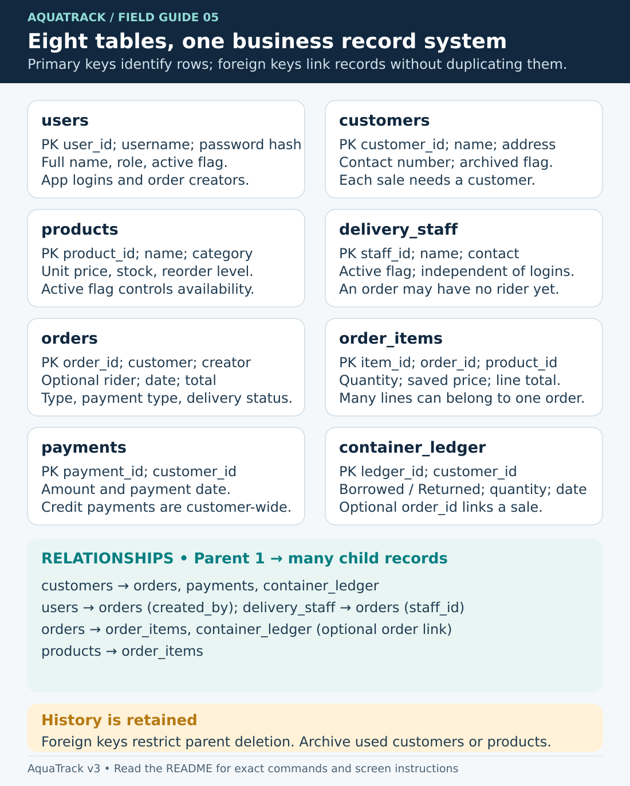

# AquaTrack: how the system works, and why it is structured this way

This guide explains the current source in [`Aquatrack_version-3`](../Aquatrack_version-3/). For installation, screen-by-screen operation, and practice exercises, start with the [repository README](../README.md). The other Java projects in this repository are independent demonstrations; their schemas and passwords are not interchangeable with AquaTrack.

**Reading convention:** “How” describes behavior visible in the code. “Why” explains the engineering benefit and tradeoff of that behavior. Unless a source comment explicitly states an intention, the rationale is an interpretation of the implementation, not a claim about the original author's private decisions. Suggested extensions are clearly identified as future work.

## 1. The business model before the code

A water refilling station needs to track several related facts that must not be confused:

| Business fact | Representation | Practical meaning |
| --- | --- | --- |
| Who buys water | `customers` | An address/contact record is required even for a walk-in order. |
| What was sold | `orders` and `order_items` | Each saved order has a customer, creator, payment type, fulfillment type, total, and item lines. |
| Whether an order was paid immediately | `orders.payment_type` | `Cash` means paid now; `Credit` adds the whole order total to the customer's balance. |
| Money collected later | `payments` | A collection reduces customer-level credit debt. It is not a new sale. |
| Reusable gallons held by a customer | `container_ledger` | Borrowed counts increase the obligation; returned counts reduce it. |
| Sellable physical stock | `products.stock_qty` | Containers and caps/seals have stock. Refills are made on demand. |
| Who can sign in | `users` | Accounts have `Staff` or `Owner/Admin` roles. |
| Who carries a delivery | `delivery_staff` | A rider is a business record, not automatically a login account. |

**Why separate these facts?** A credit sale, a later payment, and a returned bottle can happen on three different days. Recording each event separately keeps the original sale intact and makes current balances derivable. Likewise, selling a new container and lending a returnable gallon are different events: the system does not automatically connect their quantities.

There is no service/backend process between the application and the database. Each running Java desktop client connects directly to MySQL through JDBC. This reduces deployment components, but requires every workstation to have database connectivity and the configured database credentials.

## 2. Runtime and package map

The main path is:

```text
Desktop user
  -> Swing screen and input checks (ui + util)
  -> DAO method (dao)
  -> JDBC connection and prepared statement (db)
  -> MySQL tables and constraints (sql/schema.sql)
  -> model objects / report rows
  -> refreshed Swing table, message, or receipt
```

This is a small layered application, not strict MVC: panels contain presentation, event handling, and some application rules; DAOs own SQL; models carry values; utility classes share calculations and formatting. There is no separate controller/service framework, ORM, HTTP API, dependency-injection container, or connection pool.

| Area | How it is used | Why this boundary helps |
| --- | --- | --- |
| [`Main.java`](../Aquatrack_version-3/src/aquatrack/Main.java) | Selects a look and feel, checks database connectivity, and opens sign-in. | Keeps launch concerns out of business screens. |
| [`db/Database.java`](../Aquatrack_version-3/src/aquatrack/db/Database.java) | Loads Connector/J, opens connections, and offers small parameterized update/count helpers. | Centralizes the connection URL, database user/password, resource handling, and common JDBC work. |
| [`dao/`](../Aquatrack_version-3/src/aquatrack/dao/) | Reads and changes database records; the order DAO coordinates a multi-table transaction. | Screens can request a business operation without embedding its SQL. |
| [`model/`](../Aquatrack_version-3/src/aquatrack/model/) | Represents customers, products, users, orders, and computed summaries. | Named getters explain values more clearly than raw database column positions in most screen code. |
| [`ui/`](../Aquatrack_version-3/src/aquatrack/ui/) | Builds windows, listens to actions, invokes DAOs, and reports errors. | Groups each operator task with its controls and feedback. |
| [`util/`](../Aquatrack_version-3/src/aquatrack/util/) | Handles validation, prices/totals, delivery rules, password hashing, sessions, receipts, and ranking. | Reuses rules across screens and makes several calculations testable without a database. |
| [`sql/`](../Aquatrack_version-3/sql/) | Creates a fresh schema and the first owner. | Makes a new installation reproducible instead of relying on an undocumented personal database. |

### Database-access classes

| Class | Responsibility and notable behavior |
| --- | --- |
| [`CustomerDao`](../Aquatrack_version-3/src/aquatrack/dao/CustomerDao.java) | Searches active/archived/all customers; checks existing names and phone numbers; inserts/edits; detects history; archives/restores/deletes. History means any order, payment, or container movement. |
| [`ProductDao`](../Aquatrack_version-3/src/aquatrack/dao/ProductDao.java) | Loads products; checks duplicate names; changes product details, price, activity, stock, and reorder thresholds; detects whether an order has used a product. Restocking adds to the stored quantity with one SQL update. |
| [`OrderDao`](../Aquatrack_version-3/src/aquatrack/dao/OrderDao.java) | Saves a sale transaction; reloads receipt details; lists deliveries; assigns riders; conditionally updates delivery status. Its nested `PricesChangedException` carries newly priced lines back to the screen. |
| [`LedgerDao`](../Aquatrack_version-3/src/aquatrack/dao/LedgerDao.java) | Derives customer debt and gallons out; records later payments and standalone container movements; supplies an unpaid report that includes archived debtors. |
| [`DeliveryStaffDao`](../Aquatrack_version-3/src/aquatrack/dao/DeliveryStaffDao.java) | Lists, adds, and changes the active flag of rider records. The current delivery screen exposes adding riders, not a complete edit/deactivate interface. |
| [`UserDao`](../Aquatrack_version-3/src/aquatrack/dao/UserDao.java) | Finds active sign-in accounts; lists accounts; adds accounts; changes password hashes and active flags; counts active owners. |
| [`ReportDao`](../Aquatrack_version-3/src/aquatrack/dao/ReportDao.java) | Read-only sales aggregates, dashboard counts, recent orders, and customer-sale rows for ranking. |

### Model classes

| Class | What its values mean |
| --- | --- |
| [`Customer`](../Aquatrack_version-3/src/aquatrack/model/Customer.java) | Customer ID, name, address, mobile number, and archive state. |
| [`Product`](../Aquatrack_version-3/src/aquatrack/model/Product.java) | Product ID/name/category/price/stock/reorder level/activity; defines the three category constants and stock/low-stock predicates. |
| [`User`](../Aquatrack_version-3/src/aquatrack/model/User.java) | Login identity, full name, role, password hash, and active state; `isOwner()` checks the exact `Owner/Admin` role. |
| [`DeliveryStaff`](../Aquatrack_version-3/src/aquatrack/model/DeliveryStaff.java) | Rider ID, name, phone, and activity. Its display name appears in the rider selector. |
| [`OrderLine`](../Aquatrack_version-3/src/aquatrack/model/OrderLine.java) | One product's quantity, unit price, and subtotal. `priced()` calculates the subtotal from quantity and price. |
| [`CustomerOrder`](../Aquatrack_version-3/src/aquatrack/model/CustomerOrder.java) | A joined order header plus optional item lines, delivery summary, and order-linked borrowed/returned counts. |
| [`CustomerAccount`](../Aquatrack_version-3/src/aquatrack/model/CustomerAccount.java) | A calculated snapshot of a customer's gallons out and unpaid balance. `hasOpenItems()` is true when either is positive. |
| [`CustomerTotal`](../Aquatrack_version-3/src/aquatrack/model/CustomerTotal.java) | Mutable accumulator used to count a customer's orders and sum their order totals during ranking. |

Most model fields are final values. `CustomerOrder` is assembled in stages and `CustomerTotal` accumulates results. They are ordinary Java objects, not ORM entities: changing a model field does not automatically write to MySQL.

### Screens and support classes

| Class | Task implemented |
| --- | --- |
| [`LoginFrame`](../Aquatrack_version-3/src/aquatrack/ui/LoginFrame.java) | Username/password input, show-password control, asynchronous authentication, exact rejection feedback, and opening the main window. |
| [`LoginAuthenticator`](../Aquatrack_version-3/src/aquatrack/ui/LoginAuthenticator.java) | Package-private authentication logic with a replaceable user lookup; returns an explicit outcome and user. |
| [`MainFrame`](../Aquatrack_version-3/src/aquatrack/ui/MainFrame.java) | Sidebar, grouped navigation, `CardLayout`, screen refresh contract, logout, and exit confirmation. |
| [`DashboardPanel`](../Aquatrack_version-3/src/aquatrack/ui/DashboardPanel.java) | Four summary cards, a custom Java2D seven-day sales chart, and the eight most recent orders. |
| [`OrderPanel`](../Aquatrack_version-3/src/aquatrack/ui/OrderPanel.java) | Draft cart, customer/order/payment choices, gallon counts, saving, repricing review, and latest-receipt retry. |
| [`DeliveriesPanel`](../Aquatrack_version-3/src/aquatrack/ui/DeliveriesPanel.java) | Open/all delivery list, rider creation/assignment, and delivery status changes. |
| [`ContainersPanel`](../Aquatrack_version-3/src/aquatrack/ui/ContainersPanel.java) | Active-customer balances, credit collections, and borrows/returns outside a sale. |
| [`CustomersPanel`](../Aquatrack_version-3/src/aquatrack/ui/CustomersPanel.java) | Customer search and forms, duplicate checks, archive/restore, and unused-record deletion. |
| [`ProductsPanel`](../Aquatrack_version-3/src/aquatrack/ui/ProductsPanel.java) | Product list and owner-controlled catalog/price changes, archive/restore, and unused-record deletion. |
| [`InventoryPanel`](../Aquatrack_version-3/src/aquatrack/ui/InventoryPanel.java) | Stock-tracked active products, received-stock increments, and owner-controlled reorder levels. |
| [`ReportsPanel`](../Aquatrack_version-3/src/aquatrack/ui/ReportsPanel.java) | Asynchronous report selection/loading, display formatting, totals, and table printing. |
| [`AccountsPanel`](../Aquatrack_version-3/src/aquatrack/ui/AccountsPanel.java) | Owner account creation, password reset, account on/off actions, and checks against disabling oneself/the last active owner. |
| [`ReceiptDialog`](../Aquatrack_version-3/src/aquatrack/ui/ReceiptDialog.java) | Modal monospaced receipt preview with Java's system print dialog. |
| [`UiKit`](../Aquatrack_version-3/src/aquatrack/ui/UiKit.java) | Shared colors/fonts, controls, cards, table formatting, status tags, layouts, generated droplet icons, and message dialogs. |

### Utility classes

| Class | Shared rule or service |
| --- | --- |
| [`Validator`](../Aquatrack_version-3/src/aquatrack/util/Validator.java) | Trimmed required text, maximum lengths, Philippine mobile numbers, whole numbers, and money parsing. Invalid input produces an `IllegalArgumentException` with a displayable explanation. |
| [`OrderRules`](../Aquatrack_version-3/src/aquatrack/util/OrderRules.java) | Draft stock checks, the allowed gallon-return relationship, and order-total addition. |
| [`DeliveryRules`](../Aquatrack_version-3/src/aquatrack/util/DeliveryRules.java) | Status constants and messages for rider assignment, dispatch, and delivery completion. |
| [`PasswordUtil`](../Aquatrack_version-3/src/aquatrack/util/PasswordUtil.java) | Salted PBKDF2-HMAC-SHA256 creation/verification plus a command-line setup helper. |
| [`Session`](../Aquatrack_version-3/src/aquatrack/util/Session.java) | Holds the current in-memory `User`; starts/ends a desktop session and exposes owner status. |
| [`Fmt`](../Aquatrack_version-3/src/aquatrack/util/Fmt.java) | Consistent peso/date/date-time presentation. Formatting does not change stored values. |
| [`Receipt`](../Aquatrack_version-3/src/aquatrack/util/Receipt.java) | Converts a saved `CustomerOrder` to a nominally 42-character-wide text receipt. `STATION_NAME` controls the printed business name. |
| [`Ranking`](../Aquatrack_version-3/src/aquatrack/util/Ranking.java) | Groups order totals by customer ID in a `HashMap`, sorts totals descending, and returns a requested top-N list. |

## 3. Startup, sign-in, and the Swing event thread

1. `Main.main()` attempts the operating system's Swing look and feel; if unavailable, the existing default remains.
2. `SwingUtilities.invokeLater()` schedules UI startup on Swing's **event dispatch thread (EDT)**. Swing event handlers and component updates normally run on this thread.
3. Startup opens/closes one JDBC connection. A failure shows a database error and exits with status 1; success opens `LoginFrame`. This checks connectivity only, not every required table or a migration version.
4. The login screen rejects incomplete fields before querying. While a request is pending, it disables the sign-in button and credential fields to avoid overlapping attempts.
5. A `SwingWorker` runs the user lookup and password verification outside the EDT. Its `done()` method runs on the EDT to update messages and controls.
6. On success, `Session.start(user)` stores the current user; `MainFrame` opens and the login window is disposed. Logout clears the session, creates a new sign-in window, and disposes the main window.

**Why use a background worker?** A database call or password hash takes time. Running it off the EDT lets the sign-in window continue repainting. The explicit outcomes also make field-clearing behavior easy to test without opening a real database connection.

The supplied [`LoginValidationTest`](../Aquatrack_version-3/test/aquatrack/ui/LoginValidationTest.java) uses a replaceable account lookup and actual Swing fields to check authentication outcomes and field clearing. It is a standalone test, not a complete integration suite.

**Current threading limits:** login and report loading use `SwingWorker`; the startup connectivity check and many other screen queries/writes still execute synchronously on the EDT. A slow/unreachable database can therefore make those screens pause. The code does not provide a universal asynchronous DAO layer.

`MainFrame` creates its screens once and changes which card is visible. A screen implementing `MainFrame.Screen` supplies `refresh()`, invoked when selected. This keeps navigation consistent and can preserve an in-progress order when switching screens. It does not create live synchronization between workstations.

## 4. Passwords, sessions, and permissions

`UserDao.findByUsername()` selects only active users. `LoginAuthenticator` returns `ACCOUNT_NOT_FOUND` for missing/inactive accounts, `INCORRECT_PASSWORD` for a bad password on an active account, and `SUCCESS` for a match. These distinctions intentionally produce the messages documented in the usage guide.

Stored passwords use this format:

```text
pbkdf2_sha256$65536$BASE64_SALT$BASE64_DERIVED_KEY
```

The implementation generates a random 16-byte salt, runs 65,536 PBKDF2-HMAC-SHA256 iterations, derives a 256-bit key, and compares the derived bytes. A unique salt means identical passwords need not have identical stored values; the derivation adds work to password guessing. These numbers describe the existing code, not a guarantee that its password policy suits every deployment. The minimum six-character password check is in `AccountsPanel`; the standalone hash utility does not enforce that minimum.

[`bootstrap-owner.sql`](../Aquatrack_version-3/sql/bootstrap-owner.sql) creates an `Owner/Admin` only when `users` is empty and supplied variables have the expected username/name/hash format. It creates no default username or password and is not a general password-reset script. Its hash format validation confirms the expected encoding shape, not that the operator knows the corresponding password.

Role controls are implemented in the desktop interface. The sidebar hides Reports and Accounts from staff; product editing and reorder-level changes have owner checks; customer archive/delete controls are hidden from staff. DAOs generally do not re-check the signed-in user's role. Both roles use the same configured JDBC account. Consequently, UI permissions do not prevent someone with database access or a modified client from issuing database operations.

`Session` is one static in-memory reference. There are no web tokens, persistent login cookies, or server-side sessions. Turning an account off prevents later sign-ins, but does not actively revoke a `User` already held in another running client's session. The account-screen checks against disabling oneself/the last owner are UI checks, not a database-wide transactional owner-count invariant.

## 5. Database design and relationships



The authoritative schema is [`sql/schema.sql`](../Aquatrack_version-3/sql/schema.sql). It creates eight InnoDB tables with `utf8mb4` text support. Each table has an auto-increment integer primary key. Primary keys provide stable references even when a display name changes.

| Table | Main columns and constraints | Referenced by / relationship |
| --- | --- | --- |
| `users` | Unique `username` (50); `password_hash` (255); `full_name` (100); role enum; active flag checked as 0/1. | One user can create many orders through `orders.created_by`. |
| `customers` | Name (100), address (255), contact (11), archive flag checked as 0/1. | One customer can have many orders, payments, and container movements. |
| `products` | Name (100); category enum; `unit_price DECIMAL(10,2) > 0`; nonnegative stock/reorder counts; active flag. | One product can appear in many order lines. |
| `delivery_staff` | Name (100), required contact (11), active flag. | One rider may be assigned to many orders; an order can initially have no rider. |
| `orders` | Customer FK; server-generated order date; order/payment/status enums; `total_amount DECIMAL(20,2) >= 0`; nullable rider FK; required creator FK. | One order has item rows and may have order-linked container movements. |
| `order_items` | Order/product FKs; positive quantity; positive `unit_price DECIMAL(10,2)`; nonnegative `line_total DECIMAL(20,2)`. | Resolves the many-to-many relation between orders and products, preserving the price used in that sale. |
| `payments` | Customer FK; positive `amount DECIMAL(10,2)`; server-generated payment date. | A payment belongs to a customer, not an individual order. There is no `order_id` here. |
| `container_ledger` | Customer FK; `Borrowed`/`Returned`; positive quantity; optional order FK; server-generated movement date. | An order-linked movement has an `order_id`; a standalone movement leaves it null. |

The relationship summary is:

```text
users 1 ---------- many orders
customers 1 ------ many orders
delivery_staff 1 - many orders       (each order's rider is optional)
orders 1 --------- many order_items
products 1 ------- many order_items
customers 1 ------ many payments
customers 1 ------ many container_ledger
orders 1 --------- many container_ledger (each movement's order is optional)
```

The database allows an order header without item rows structurally; `OrderDao` enforces at least one item for application-created orders. The database checks positive/nonnegative columns, but does not independently prove `line_total = quantity × unit_price` or `order total = sum of lines`. Application calculations establish those relationships.

**Why eight tables?** Customer details and product definitions are stored once and referenced by sales. Order headers avoid repeating order-level details on every line. Separate payments and container movements retain the timeline needed to calculate balances. This is relational normalization with deliberate sale-price snapshots in `order_items`.

**Why archive instead of cascade delete?** Foreign keys use the default restrictive behavior: deleting a customer/product/user/rider cannot silently delete dependent history. An archived customer is hidden from new orders but remains joinable for existing records. The application allows permanent removal only when its history check finds no dependencies; the foreign key remains a second line of protection.

Names and contact numbers are not uniquely constrained in the customer table; product names and account full names are not uniquely constrained either. Forms perform duplicate lookups, including archived/inactive records, before saving. `users.username` has a database unique constraint. These different guarantees matter for concurrent clients: a pre-save lookup alone can race another insert.

Indexes support common lookup/filter paths, including order dates, customer/payment type, delivery status/date, active product category, customer archive/name, and payment/movement customer IDs. Indexes accelerate suitable queries at the cost of additional storage and write work. A name search using `%text%` is still not equivalent to an indexed exact lookup.

The schema uses `CREATE TABLE IF NOT EXISTS`; this preserves existing tables but does not upgrade their columns. There is no migration history table or automatic compatibility repair for a pre-existing custom schema.

## 6. The formulas, with worked examples

### Money and order totals

```text
Line subtotal = quantity × saved unit price
Order total   = sum of all line subtotals
```

For example, two refills at PHP 25.00 plus one new container at PHP 150.00 produce `2 × 25.00 + 1 × 150.00 = PHP 200.00`. The container product's stock falls by one; the refill has no stock decrement. Borrowed/returned gallons change only if the operator records them separately.

`OrderLine.priced()` uses `BigDecimal` multiplication and scale 2; `OrderRules.total()` adds decimal subtotals. SQL uses `DECIMAL`. **Why?** Binary floating-point values such as `double` cannot exactly represent every decimal price. Decimal arithmetic preserves the two-place financial values used here. The dashboard converts amounts to `double` only when computing chart geometry; that drawing conversion does not calculate saved sale totals.

`Validator.requireMoney()` accepts nonnegative numeric input up to `99,999,999.99`, requires no more than two meaningful decimal places, and returns scale 2. Product prices and recorded payments add a strictly-positive check at the screen level. Tax, discount, delivery-fee, tendered-cash, and change calculations are not implemented.

### Credit balance

```text
Unpaid(customer) = sum(all their Credit order totals)
                 - sum(all their later payments)
```

A PHP 200.00 credit order followed by a PHP 75.00 collection gives PHP 125.00 unpaid. The sale remains classified `Credit`; collecting the balance does not rewrite it to `Cash`. There is no per-invoice allocation, due date, interest, credit limit, or partial-payment input during order creation. To collect part of a credit order, save it as Credit and then record the amount actually received in Containers & Balances.

A Cash order does not create a `payments` row: the payment type represents immediate settlement. Therefore, adding an extra ledger payment for that cash sale would be conceptually incorrect; the payments screen is for reducing existing credit debt.

### Borrowed gallons

```text
Gallons out(customer) = sum(Borrowed quantities) - sum(Returned quantities)
After one sale       = previous gallons out + borrowed now - returned now
Allowed sale return  = returned now <= previous gallons out + borrowed now
```

If a customer has three gallons out, borrows two and returns four on the next sale, the new balance is one. Returning six would be rejected. With a standalone return, no simultaneous borrow is part of the action, so the entered return cannot exceed the balance read by `LedgerDao`.

This ledger counts returnable units with a customer. It does not measure water volume, track individual serial numbers, price deposits, or add returned bottles to `products.stock_qty`.

### Inventory and reorder alerts

```text
Tracked product: category != Refill
After a sale:   stock = previous stock - quantity sold
After receipt:  stock = previous stock + quantity received
Low stock:     active AND tracked AND stock <= reorder level
```

For example, a cap/seal product at 20 units with a reorder level of 5 is not low. Selling 15 leaves 5 and triggers the low-stock condition. Receiving 30 then raises stock to 35. Inventory has no separate movement/audit table, purchase-order process, automatic water-to-cap consumption, or stock-adjustment history.

### Reports

```text
Sales(period) = sum(order totals whose order_date is within the period)
Cash sales    = sum(those orders with payment_type = Cash)
Credit sales  = sum(those orders with payment_type = Credit)
Total sales   = Cash sales + Credit sales
```

These are recorded sales, not cash-in-bank or profit. Pending deliveries already contribute on their order date. Later collections reduce debt but do not add another sale. Costs, margins, refunds, and tax reports are absent.

`ReportDao` uses inclusive start/exclusive end timestamps, for example `2026-10-01 00:00 <= order_date < 2026-11-01 00:00` for October. This includes the whole final day without requiring a guessed last fractional second and leaves range comparisons on `order_date` suitable for an index. The selected year/month is interpreted through Java local dates; database timestamps use the database server clock. Keep workstation/server timezone behavior consistent with the configured `Asia/Manila` JDBC setting.

## 7. What happens when “Save and print receipt” is pressed

This is the core multi-record operation. Read [`OrderPanel.save()`](../Aquatrack_version-3/src/aquatrack/ui/OrderPanel.java) alongside [`OrderDao.placeOrder()`](../Aquatrack_version-3/src/aquatrack/dao/OrderDao.java).

1. **Validate the draft.** The screen requires a selected customer and a nonempty cart. It commits typed spinner edits so validation sees the entered value. The borrowed/returned spinners permit 0–500 and the quantity spinner permits 1–999 per addition. Adding the same product combines its quantities into one cart line.
2. **Start one database transaction.** The DAO rejects an empty request, opens a JDBC connection, and sets auto-commit off. All following sale writes use that same connection.
3. **Lock and re-check the customer.** A `SELECT ... FOR UPDATE` locks the active customer row. A missing/archived customer aborts the sale. This serializes concurrent sales for the same customer while checking their gallon balance.
4. **Lock and re-read products.** For each requested line, the DAO locks its product row and reads the current name, category, price, stock, and active flag. Missing/inactive products and insufficient stock abort the operation. Tracked stock is decremented on the transaction connection.
5. **Require price review if needed.** If any current database price differs from the cart price, `PricesChangedException` carries updated lines. The transaction rolls back, including stock changes already made. The UI replaces the cart prices, updates the total, and asks the operator to review and save again. A changed catalog price is never silently accepted as an already-reviewed sale total.
6. **Check the gallon relationship.** The DAO calculates the customer's existing movements on the same transaction connection and rejects excessive returns using `OrderRules.gallonProblem()`.
7. **Insert the order header.** Delivery starts as `Pending`; walk-in starts as `Delivered`. The header stores customer, order/payment types, computed total, and signed-in creator. JDBC obtains the generated order ID.
8. **Insert item lines and movements.** Item inserts are batched. Positive borrowed/returned counts create separate ledger rows linked to the new order; zero counts create no movement row.
9. **Commit or roll back.** Success commits once and returns the order ID. SQL errors or runtime exceptions trigger rollback and are rethrown. Thus the ordinary save path does not intentionally leave half a sale, committed stock depletion without its order, or only part of the sale's container movements.
10. **Separate the receipt from the saved sale.** Once an ID returns, the UI records it, clears the draft, enables receipt access, reloads choices, and fetches the receipt. If the receipt query fails, the sale remains saved and the button becomes a receipt retry. Printing happens after the commit and cannot undo it.

**Why lock after checking in the UI?** A screen can be stale. Two operators may both see ten containers and each try to sell eight. The transaction's product lock makes one wait; its stock check then sees the remaining quantity, preventing both ordinary application sales from using the same units. The UI's earlier stock check is useful feedback, but the locked database check decides whether the sale can proceed.

**Why save prices on the order line?** Updating the catalog price tomorrow should not recalculate yesterday's sale. Each line keeps its saved price and subtotal, and the header keeps its total.

**What is not guaranteed?** Product locks are acquired in cart order rather than globally sorted order; overlapping carts can deadlock and produce an SQL failure. There is no automatic deadlock retry. There is also no request identifier for deduplicating a retried sale after an ambiguous network failure around commit. If a connection is lost at that boundary, verify whether an order was saved before manually entering it again.

Standalone payments and container movements do **not** use this sale transaction: see the next section. The customer lock only serializes cooperating operations that take that lock; it is not a universal lock automatically applied by every DAO.

## 8. Later collections, returns, and concurrency boundaries

`LedgerDao.account()` derives one active customer's current position using aggregate subqueries. `recordPayment()` loads that position, checks that a positive unpaid balance exists and that the payment is not larger, then inserts the payment. The UI validates a positive amount. `recordMovement()` similarly loads the position and checks return counts before inserting; the UI validates a positive whole-number quantity.

**Current limitation:** the read and insert are separate database operations/connections, with no surrounding transaction or customer-row lock. Two workstations can both pass the same balance check before either insert becomes visible. That means simultaneous payments or returns for the same customer can exceed the intended balance. Coordinate those operations per customer until the implementation gains a common transactional locking rule. Do not describe these paths as having the same concurrency guarantees as order saving.

The Containers & Balances screen reads only active customers. Its “All customers” total means all active customers loaded for that screen, even if the open-items filter hides some rows. The owner Unpaid balances report explicitly includes both active and archived customers who owe more than zero and labels their status. Restore an archived customer before recording a payment/return through the ordinary active-customer screen.

There is no immutable audit trail linking every later collection to a staff account: `payments` contains customer, amount, and date, and standalone `container_ledger` rows contain customer, movement, quantity, and date. A broader audit requirement would need schema and write-path changes.

## 9. Delivery state and stale-screen protection

The usual operating workflow is:

```text
Save Delivery order -> Pending -> Assign rider -> Out for Delivery -> Delivered
Save Walk-in order  -> Delivered
```

`DeliveryRules.canGoOut()` permits dispatch only from Pending and only when the loaded order has a rider. A delivered order cannot change riders through the normal UI. `OrderDao.assignRider()` also restricts its SQL update to an undelivered Delivery order.

**Actual completion rule:** `DeliveryRules.canDeliver()` only rejects an already delivered order. The current UI therefore also permits **Pending → Delivered directly**, even without a rider. The heading describing a three-stage sequence is guidance, not a strictly enforced state machine.

`OrderDao.setStatus()` updates with `WHERE order_id = ? AND delivery_status = ?`, using the status the operator saw as the expected old value. If another workstation already changed that status, zero rows change and the screen warns and reloads. This is an optimistic concurrency check: it detects a stale status without holding a lock for as long as the operator studies the screen.

The DAO's status method does not independently validate the allowed transition or rider requirement; those checks live in the screen/rules. Rider assignment does not compare an expected prior rider, so two concurrent assignments can overwrite one another. These are the limits of the current design rather than promises of centralized workflow enforcement.

## 10. Reports, ranking, and responsive loading

Daily sales returns days with sales in the chosen month. Monthly SQL results contain months with sales; `ReportsPanel` fills missing months with zero rows so the screen always displays all twelve. Best customers is an all-time top ten, including cash and credit order totals; it is not filtered by the year/month selectors. Unpaid balances is a current customer balance report and also ignores those selectors. The UI disables filters that do not apply.

`Ranking.topCustomers()` makes one pass over order rows and aggregates by customer ID. For `n` orders and `c` distinct customers, expected grouping work is O(n), sorting is O(c log c), and the grouping map uses O(c) additional space. `ReportDao.customerSales()` first loads all matching order rows into memory, so the entire report uses O(n + c) memory. Equal spending totals have no explicit secondary tie-breaker. A large deployment could aggregate/order/limit in SQL instead; the existing approach makes the grouping algorithm visible in Java for learning and simple reuse.

The Reports screen runs loading and aggregation in a `SwingWorker`. Selecting another report cancels the previous worker and increments a request number. Since cancelling a worker may not immediately stop JDBC, the completion handler also checks that request number before displaying results. This prevents an old, slower request from replacing the newly chosen report. Print is disabled while loading or after a failure, and the print title belongs to the successfully loaded result.

Dashboard refresh issues multiple independent queries, so its cards are not guaranteed to represent one transactionally consistent instant while other workstations are saving. There is no background push feed; reopening a screen requests a fresh view.

## 11. Receipts and historical records

`OrderDao.findById()` loads a joined header, saved item quantities/prices/totals, and movements linked to that order. `Receipt.format()` renders them as text; `ReceiptDialog` delegates printing to Swing/Java printing. A PDF printer is an operating-system option, not an application PDF-export feature.

Saved prices, line totals, and order totals remain historical values. Customer name/address/contact, product names, creator name, and rider name are joined from their current records when reloading. Renaming a product or editing a customer can therefore alter the wording of a reloaded old receipt. Archiving preserves the referenced records; it does not freeze their text.

The latest receipt ID is stored only in the current `OrderPanel` instance. It is not a durable “last receipt” setting across logout/restart, and the current UI is not a full searchable receipt archive. Text labels and long names may be shortened to fit the receipt format. Printing failure does not mean the sale failed.

## 12. Validation and error handling

Three different checks serve different purposes:

| Location | Example | Benefit and boundary |
| --- | --- | --- |
| Swing form / utility | Required name, `09` plus nine digits, positive quantity, owner-only controls. | Fast feedback and usable messages; a modified client/direct SQL can bypass these checks. |
| DAO operation | Locked current stock and price during a sale; expected delivery status on update. | Rechecks facts that can change after a screen loads; guarantees differ by operation. |
| Database | Foreign keys, unique username, enums, positive/nonnegative numeric checks. | Rejects invalid persisted rows from any client, within the constraints actually declared. |

Prepared statements put input values in `?` parameters instead of concatenating them into SQL text. Dynamic query fragments in these DAOs choose predefined filters/clauses. Parameterization keeps values distinct from SQL syntax; it does not itself grant/deny a user's business permission.

`try-with-resources` closes connections, statements, and result sets when scopes finish. Many DAO failures propagate as `SQLException`; screens catch and show a message. Input/business-rule failures are commonly `IllegalArgumentException`. `PricesChangedException` is a specific rule failure with data the UI can act on. This separation makes “edit the input,” “review updated prices,” and “fix database connectivity” different user responses.

Not every declared rule is duplicated in every layer. For example, screen-level positivity checks do not turn `LedgerDao` into a complete standalone public API. When adding a new caller, inspect both the screen and DAO assumptions instead of assuming the DAO validates all inputs and permissions.

## 13. Build and distribution choices

The project uses Java 17 source/target settings, Swing from the JDK, JDBC, and a bundled MySQL Connector/J JAR. [`nbproject/project.properties`](../Aquatrack_version-3/nbproject/project.properties) selects `aquatrack.Main`; [`build.xml`](../Aquatrack_version-3/build.xml) uses the NetBeans Ant build. Direct `javac` commands in the README provide an IDE-independent path.

**Why this setup?** A beginner can follow ordinary Java classes, SQL, and Swing without learning a web stack or ORM. Including the connector and NetBeans shared files reduces setup friction. The tradeoff is manual dependency upkeep and less portable configuration: connection settings are hardcoded in `Database.java`, so changing them requires recompilation. There is no `.env` loader or runtime configuration editor.

An Ant distribution includes an application JAR and its companion library directory. The whole directory must travel together. It still needs Java, a desktop display, and a reachable database; it is not an installer with an embedded database. Source in Git is not a backup of MySQL data.

## 14. Design choices and tradeoffs at a glance

| Observed choice | Engineering benefit | Cost or current limit |
| --- | --- | --- |
| Swing desktop plus direct JDBC | Few moving parts; familiar local desktop workflow. | Each client needs database access/configuration; no central API authorization or mobile/web client. |
| Small packages and ordinary Java objects | Easy to trace screen → DAO → SQL; limited framework magic. | Panels still combine presentation and application logic; adding another client would require extracting rules. |
| `BigDecimal` plus SQL `DECIMAL` | Reliable decimal money arithmetic. | All future monetary inputs/calculations must keep using compatible precision/scale. |
| Order transaction with row locks | Order, lines, tracked stock, and order-linked movements commit together. | Lock waits/deadlocks are possible; later ledger actions do not yet share the same locking rule. |
| Saved sale prices and totals | Catalog price changes preserve recorded monetary values. | Display names/contact details are live joins rather than historical snapshots. |
| Ledger-derived balances | Each collection/movement remains a row; balance can be recomputed. | No per-invoice payment allocation; growing ledgers may need query/index work. |
| Archive flags and restrictive FKs | History survives routine retirement of records. | Archived debtors require deliberate handling; archive does not mean “settled.” |
| Shared `UiKit`, formatters, and rules | Consistent controls/messages and less repetition. | Shared changes affect many screens and require visual regression checks. |
| Background login/report work | Those tasks remain responsive; stale report completion is rejected. | Many other database operations still run on the EDT. |
| HashMap aggregation in Java | Makes the ranking algorithm explicit and understandable. | Loads all customer-sale rows; SQL aggregation scales better for large histories. |
| Fresh-install SQL scripts | Reproducible clean setup and no bundled business data. | No migration framework, built-in backup scheduler, or restore UI. |

## 15. Where to extend the system

The following are implementation directions, not features already present:

| Desired change | Files/areas to start with | Related behavior to verify |
| --- | --- | --- |
| Change station name/receipt layout | `util/Receipt`, `ui/ReceiptDialog` | Long names, large totals, page width, and actual printer output. |
| Add a product category | `model/Product`, `ui/ProductsPanel`, schema enum, `OrderDao` tracking rule | Whether it consumes stock; inventory and low-stock lists; existing-data migration. |
| Add tax, discount, or delivery fee | `OrderLine`, `OrderRules`, `OrderPanel`, `OrderDao`, schema, reports/receipt | Rounding policy, historical snapshots, totals, refund policy, and report semantics. |
| Make payments/returns safe across clients | `LedgerDao`, shared customer locking used by `OrderDao` | One transaction per balance check/write, concurrent same-customer operations, rollback, and archived-state changes. |
| Enforce a strict delivery sequence | `DeliveryRules`, `DeliveriesPanel`, `OrderDao.setStatus` | Allowed old/new state and rider conditions enforced together at write time; stale screens and competing assignments. |
| Preserve exact historical receipt wording | `orders`/`order_items` snapshot columns and `OrderDao` | New-sale snapshots, old-row migration strategy, and receipt lookup behavior. |
| Add cancellation/refunds | New schema and domain rules spanning orders, stock, payments, movements, reports | Reversal records, authorization, double reversal prevention, receipt history, and retained audit trail. |
| Support larger datasets | `ReportDao`, `Ranking`, all list queries | SQL aggregation, pagination, indexes, query plans, memory, and screen responsiveness. |
| Externalize database settings | `Database`, launch/package instructions | Missing/invalid configuration, secrets handling, connection timeouts, and workstation distribution. |
| Add a new screen | New `ui` panel implementing `MainFrame.Screen`; register it in `MainFrame` | Role visibility, refresh timing, error states, keyboard usability, and minimum window size. |
| Add a web/mobile client or stronger authorization | Introduce a server/service boundary | Move business validation and permission checks to trusted server operations; do not expose the JDBC credentials to browsers. |

When modifying a business rule, trace it through **input → calculation → DAO → schema → reports → receipt**. A new field that appears on a form but is not saved, or a new fee saved in orders but omitted from receipts, creates a misleading system.

## 16. A productive code-reading route

1. Read `Main`, `Database`, `LoginFrame`, and `LoginAuthenticator` to understand startup and the two distinct identities: database account and application login.
2. Read `MainFrame` and one simple form such as Customers alongside its DAO and model. Follow one button from listener to prepared statement and back to the refreshed table.
3. Read `Product`, `OrderLine`, and `OrderRules`, then trace `OrderPanel.save()` through the transaction in `OrderDao`.
4. Read the schema together with `LedgerDao`; calculate a sample credit/gallon balance by hand and compare it with the SQL expressions.
5. Read `DeliveryRules` and the conditional status SQL to understand friendly UI checks versus database stale-state protection.
6. Read `ReportDao`, `Ranking`, and `ReportsPanel` to connect aggregates, background work, and display formatting.
7. Read the receipt formatter and supplied login test to see two small, focused areas that can be understood independently.

This sequence follows a complete business event through the code, so each class has a purpose before you examine its implementation details.
